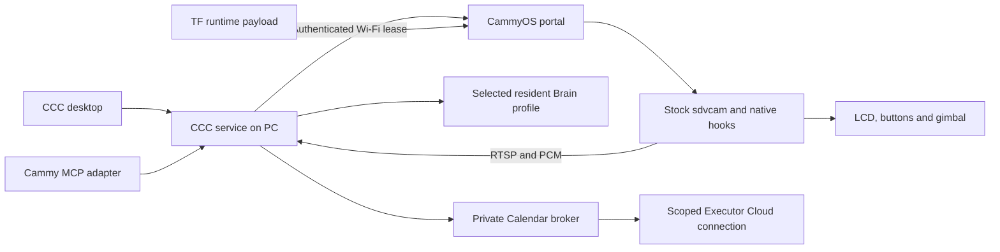

# M105 and CammyOS architecture

How the hardware, the TF runtime and the PC services fit together, as measured.
Direction and milestones are in [docs/PLAN.md](docs/PLAN.md), and current state is in
[docs/STATUS.md](docs/STATUS.md). Sections describing superseded plans (Reachy
target, GPT-Live/T3 brain, the native-ownership work packages, v0.3) moved to
[docs/archive/architecture-history-2026-11-16.md](docs/archive/architecture-history-2026-11-16.md)
on 2026-11-16.

CammyOS 0.7.6 draws speaking animation locally on the M105. C3 sends one
lease-scoped face command when the speaker begins playback. The GUI alternates
two immutable mouth frames every 180 ms and places an empty balloon below the
face. Fin and Fur has a pair of frames for each foreground character. The same
GUI owner handles menu priority, pack changes and lease expiry. Both packs were
observed on the physical LCD on 2026-11-17. Native media is started on demand by
C3. Boot guards remain enabled. [Hardware results](docs/STATUS.md)

## System at a glance

CCC owns the camera lease, profile selection and desktop access rules.
Resident Brain turns use the selected Codex or Claude Code provider.
The family deployment uses local speech and a separate Calendar broker.
The legacy T3 Brain and finite-session controls are opt-in paths.
[Brain modes](docs/BRAIN.md) · [Control Center](docs/C3.md)

## Hardware identification

| Component | Identified fact or evidence | Limits of the evidence |
|---|---|---|
| Device | Ausek AT-M105 pocket/gimbal camera; FCC ID `2BCMP-AT-M105`; also investigated under Ourlife/M105/N105 names | The report's related certified model names do not establish firmware interchangeability. |
| PCB | Photo appears to show `J05_V2.1` | This is an unconfirmed photographic reading, not an ordering code or schematic. |
| SoC / CPU | Device tree includes `allwinner,v853`; live CPU reports `sun8iw21`, ARM Cortex-A7 | Earlier V316 references came from shared SDKs and were hypotheses, not this unit's live identification. |
| DRAM | Boot information reports 512 MiB; boot0 contains DDR3 parameters including 912 MHz | Linux-available memory is smaller; the actual chip marking and full board timing schematic were not independently read. |
| Internal flash | 16 MiB SPI-NOR, seven exposed MTD partitions | The physical marking of the photographed eight-pin IC was not read; don't identify it purely from its board position. |
| TF/microSD | Camera-formatted 32 GB FAT32 card tested; vendor documentation advertises support up to 256 GB | 256 GB was not tested. Card contents and boot sectors have different roles. |
| USB | USB-C connector, vendor specifies USB 2.0; charging, storage and webcam selections | USB ADB and FEL are distinct modes. A USB network gadget and USB audio-host support have not been verified. |
| Radio | ECR6600S driver `wlan_ecr6600.ko` and matching firmware; tested on 2.4 GHz | Managed and AP modes were demonstrated; the radio did not advertise supported simultaneous AP/STA combinations. |
| Antenna | Supplied antenna documentation lists FPC part `WF3113B-0814L-125`, 125 mm coax and 0.68 dBi peak gain at 2450 MHz | The installation illustration depicts another host layout; exact installed connector series and physical part markings remain unconfirmed. |
| Battery / power | Vendor documentation gives a nominal 3.7 V, 2400 mAh battery; manual recommends a 5 V/2 A USB supply | Actual battery health, current draw and sustained charging balance were not measured. A charger-connected 12-minute test is not a 24-hour endurance test. |
| Camera sensor | Running kernel uses an `imx298_mipi` driver | The sensor's physical marking and calibration have not been independently verified. |
| Display | `/dev/fb0` was read; observed 356×400 physical mode, 356×800 virtual storage, 32 bits/pixel and 1424-byte stride; stock `sdvcam` owns `/dev/fb0` and `/dev/disp` | Recheck pixel layout, rotation, stride and display ownership before rendering. Stock startup also contains a different `SCREEN_INFO` value; don't hard-code it as the actual mode. |
| Audio | ALSA card 0 `audiocodec`; card 1 `snddaudio0`; native microphone cue capture verified; Adam heard recorded beeps from Cammy during stock playback | Remote CammyOS speech, speaker rating, microphone geometry, duplex capability and acoustic quality remain unverified. |
| Motor/gimbal | Leased USB input hold remotely moved head roughly90° left, confirmed by Adam. He reports ~350° total range with forward near the left end. Stock app owns motor resources | Angular calibration, feedback, Wi-Fi-only actuation and mid-travel physical stop latency remain unverified. USB button release is observed; native pose API remains unavailable. |
| Power management | Device tree exposes AXP2101-related nodes; native app opens `/dev/watchdog` | A complete power schematic and independent physical PMIC identification are unavailable. |
| Physical controls | Front controls correspond to mode, record, directions and OK; side power/menu-related buttons and reset are documented | Exact electrical assignments and safe remapping require verification. |

The supplied board photo, diagrams and sources are in the local sibling workspace: [hardware and setup report](../Cammy%20Bot/M105%20investigation/outputs/ausek-m105-hardware-and-setup.md). These are not complete electrical schematics or a component BOM.

## Stock software, boot and storage

The original system is an Allwinner Tina/OpenWrt-derived ARM userspace with Linux `4.9.191`, U-Boot `2018.07`, an eGON boot0 and the vendor `/usr/bin/sdvcam` media/UI application. MiniGUI resources and LVGL-related application symbols were found. Vendor libraries include media/ISP and other components whose full source provenance has not been established. A kernel log reported `sunxi_secure: normal`; this is not a complete secure-boot/eFuse audit.

The live MTD layout was captured before raw-image reconstruction:

| Partition | Offset | Size | Role |
|---|---:|---:|---|
| `mtd0` | `0x000000` | `0x100000` | boot0/U-Boot |
| `mtd1` | `0x100000` | `0x100000` | boot resources |
| `mtd2` | `0x200000` | `0x320000` | kernel/boot |
| `mtd3` | `0x520000` | `0x9e0000` | SquashFS rootfs |
| `mtd4` | `0xf00000` | `0x080000` | JFFS2 writable overlay |
| `mtd5` | `0xf80000` | `0x040000` | environment |
| `mtd6` | `0xfc0000` | `0x040000` | UDISK |

The original seven partition dumps total 16,777,216 bytes. They were taken from a running system; bootloader and rootfs were reread independently. Later FEL access produced two matching complete offline reads. Fixed partitions matched the earlier backup; mutable overlay data had changed. The backups and extracted vendor data are private.

The 512 KiB JFFS2 overlay carries the boot hooks, Wi-Fi settings, selector
authority and boot evidence. November 22 installation evidence records a
122,880-byte free-space reading against a 163,840-byte install requirement.
Manual archival raised the reading to 172,032 bytes.
[Install evidence](docs/STATUS.md#nor-overlay-maintenance)

The installer now archives legacy NOR items on LAB before checking
headroom. The factory rollback is recognized by the pinned stock S01app
SHA-256. The replacement receipt's rollback and paths referenced by
unfinished install or rollback journals also stay on NOR. For each obsolete
item, the installer matches camera MD5s to PC copies, syncs the copies and
receipt to LAB, then removes individual files and syncs NOR. An interrupted
directory removal can be resumed using the remaining files. USB lifecycle
rollback uses the journal's verified PC before-images even after old NOR
evidence is archived.

In steady state, a finished install holds the factory rollback, up to two
nonfactory rollback directories, and its own selector archive. At the
observed sizes, the two nonfactory copies contribute about 106 KB raw and
the factory S01app contributes 4,246 bytes. Selector and health history
account for at most four records of up to 512 bytes each. The selector
and health code reserve room by evicting the oldest recognized records
by modification time before moving new evidence. The active claim, guard,
fault, and spent retry ledgers remain outside history and control recovery.
These counts are independent of completed installs and ordinary healthy
boots. Unfinished journals and manual rearms can retain extra archives
until resolved or pruned. Active files, directory and JFFS2 metadata,
compression and garbage collection affect physical use. Free-space
readback remains the install gate and includes a 32 KiB reserve in the
required budget. The retention changes have offline fixture coverage.
[Hardware verification](docs/PLAN.md#nor-overlay-verification)

The stock-derived candidate rootfs was **9,572,352 bytes**, within the **10,354,688-byte** rootfs partition. The private reconstructed candidate preserves the original kernel and bootloader and was validated against staged content; it is a raw SPI layout, not a PhoenixCard package. It is **not installed**. Original portal code also ran in an actual-camera RAM chroot, but that shared the stock kernel and media app. [Validation](docs/VALIDATION.md) and [boot strategy](docs/BOOT-STRATEGY.md) contain artifact and test details.

Two direct kernel handoffs from FEL/RAM did not produce a USB shell. Board-specific boot0 DRAM parameters supported two 64 KiB RAM write/readback checks; uploaded kernel/DTB/trampoline readbacks matched. Root cause of the later boot failure is unlocalized. Full alternate-root/kernel boot, SPI programming, flash restoration and rollback remain unverified.

## Vendor media and control paths

The camera's stock app interface and the custom Cammy portal are different services. Historical direct-AP observations:

| Path | Finding | Status |
|---|---|---|
| `192.168.10.1:8082` | Stock QZ-style HTTP API and resources | Device/recording/storage queries worked on the direct AP; individual commands and availability depend on app state. |
| `192.168.10.1:9999` | Stock event/control socket | Sending `{"cmd_id":"4016"}` and retaining the connection enabled a tested preview; exact internal semantics of 4016 are unknown. |
| `rtsp://<camera-ip>:8554/ch00` | Stock H.264 preview after native Wi-Fi initialization/home-IP recovery |640×360 native video received over home Wi-Fi for35s in the latest test;30-minute stability, synchronized latency and automatic startup remain open. Historical AP address is192.168.10.1. |
| RTSP audio | SDP advertises AAC/8kHz mono | No audio RTP packets in the latest observation; TCP and UDP decoders got zero audio. |
| ALSA microphone | Physical card0 capture; shared16kHz mono PCM prototype |20s captured over USB simultaneously with live video; speech recognized. Native preview owns capture, so hardware cannot simply be reopened exclusively. Temporary sharing configuration was restored. Wi-Fi microphone transport and duplex remain open. |
| ALSA speaker | Short low-volume test waveform accepted by playback | Audibility and speech quality are not confirmed. |
| Framebuffer | A framebuffer copy was read | Arbitrary drawing, exclusive ownership, face animation and coexistence with the vendor UI are not established. |
| Motor control | HDV CAM app contains direction command `4005` and related controls | Its decompiled request concatenation appears malformed (`4005par=`); actual wire encoding and safe camera behavior are unverified. Do not infer powered tilt from the generic app's buttons. |

The app also exposes device information (`2001`), pocket status (`2017`), menu data (`3020`), system settings (`2006`), storage (`2004`), recording state (`2005`) and battery fields (`2009`) in its QZ client. Those are app-derived protocol observations, not a guarantee that every command is implemented on this camera. The generic `libaw_net_client` contains TUTK/IOTC operations including speaker/audio functions; they are a separate protocol family and have not established M105 two-way audio.

Home-Wi-Fi video was demonstrated on2026-11-15 after stock Wi-Fi-screen
initialization and DHCP recovery. Earlier boot/probe tests correctly observed
missing listeners or SDP without decoded frames. `preview.available` alone still
reflects an enabled control backend, not fresh media. The new35s stream is an
entry proof; automatic startup and sustained acceptance remain unfinished.

### Native media lifecycle and USB mode — latest findings

**Observed:** the portal remains reachable at the USB mode-selection screen while
all queried PCM paths are closed and RTSP8554 is absent. After Adam selected
Charging Mode and confirmed normal live camera view, stock playback reopened at
16kHz mono S16_LE, period960/buffer7680. Capture remained closed. The preview hook
still did not produce a listener within6.13seconds. USB selection and native media
readiness must therefore be recorded independently of gateway connectivity.

**Static evidence:** the saved vendor executable matches the live executable's
SHA256. Its presenter `MSG_SOFTAP_ENABLE` branch calls RTSP creation and stream-sender
initialization. The current hook opens event9999 and sends `{"cmd_id":"4016"}`;
that is not proof the server-creation branch ran. **Hypothesis:** managed Wi-Fi
startup bypasses a required native media initialization step. Another recreate
caller exists, so the event is not established as the only entry. No native event
was injected and no alternate initialization has been verified.

**Audio:** read-only mixer inspection found MIC1 Switch off, gain30/31 and ADC/DAC
volume160. These are observations, not quality recommendations. A native PCM
capability query timed out; no sample-rate range was established and no residual
probe process was found. Future capture/playback hooks need routing restoration,
format/freshness reporting and arbitration with the stock app. No new audio was
captured or played during these targeted probes.

**Motor:** the UART send routine builds a13-byte packet with AA/BB framing, a
flag/operation byte, four big-endian16-bit coordinate fields, speed and an additive
checksum. Its480/270 coordinate checks and speed1..5 are static protocol facts,
not physical angles or safe travel limits. The separate I2C motor code must not be
assumed to address the same function. No UART read/write, I2C scan or motor command
was performed. Physical feedback and bounded stop behavior remain prerequisites.

**IPC/display:** `sdvcam` owns `/tmp/event/unix.domain`; local code and the
`udev_handler` executable indicate a hotplug byte channel. This is not a verified
generic presenter-control API. Stock display ownership is confirmed; face rendering
needs an ownership contract rather than ad-hoc VRAM writes. The four actual
face/gimbal/capture/speech hooks were checked under an authenticated lease and
returned501. Final CammyOS state was owner null and preview off.

Detailed evidence, code addresses and next adapter gates:
[targeted probes](docs/TARGETED-PROBES-2026-11-14.md),
[earlier read-only probe](docs/PROBE-2026-11-14.md), and
[wireless acceptance](docs/HOME-WIFI.md).

### PCCAM USB video/audio — observed, acceptance incomplete

On2026-11-14 PCCAM enumerated as `18d1:100d`, serial `20080411`, on USB port1-4.
Descriptors advertise UVC1.00 bulk MJPEG1280×720 at approximately30fps, plus USB
Audio capture and playback, each mono S16_LE/16kHz. `snd-usb-audio` bound both
audio directions. UVC negotiation timed out on control requests, including
GET_CUR(PROBE), and the host created no M105 video node. Existing video0/video1
belonged to the separate Poly device and were not used. Descriptor capabilities
must not be presented as working video/audio.

An experimental PC CammyOS hook, `host/usb_media_probe.py`, validates serial and
USB ancestry, owns a body lease, monitors stop/disconnect and runs a bounded
standard-driver capture to a private PC file. A3second test returned48000 samples,
all zero. Actual microphone routing/intelligibility and speaker output remain
unverified. This is a host probe, not an implemented body audio adapter or the
planned probe-job API. No raw USB override, driver detach or mixer write occurred.

The camera was returned to Charging Mode/live view; home runtime0.2 became
reachable with owner null/preview off after a fresh boot. Do not claim seamless
mode switching from this observation. Mass-storage mode remains pending and must
be investigated read-only with exclusive filesystem ownership. The external
reader remains the verified TF update path.

### Native microphone and USB duplex follow-up — 2026-11-14

The M105 native AAC route now has real acoustic-input proof: a known700/1100/
1700Hz cue from P15 was detected in order, with tone energy fractions0.991/0.969/
0.863. The same test reported physical card0 microphone RUNNING at16kHz mono.
This is signal-path evidence; speech intelligibility and live conversation are
still unverified.

Two standard-driver USB tests then ran simultaneous capture/playback under
CammyOS leases. Both returned80,000 exact-zero USB microphone samples. The
operator heard only the later P15 cue, not the earlier USB speaker cue.
During the second test, both host USB streams were RUNNING while Cammy exposed
UAC1Gadget card2 but kept its physical card0 microphone **closed**. An audio
bridge between these paths is the next target; a new driver is not established
as necessary. Native speaker output and useful physical duplex remain unproven.

Stock code contains `WebRtcAecProcess` and ALSA `Capture*MicPlusAec`/I2SRX
reference routes. Presence does not prove active noise/echo cancellation.
Cammy is restored to Charging Mode/live view. Accepted720p/30 Low values5/2
remain selected; current original stock hashes were reverified through the
existing ADB server5037 after re-enumeration. See [report](docs/AUDIO-TESTS-2026-11-14.md).

### Android QZ preview sequence — additional static evidence

The current preview hook was derived from the Android app. QZ `I.m()` returns the
RTSP8554/ch00 URL, `I.y()` starts its event client, and `C0486f.a()` connects to
the hard-coded AP endpoint192.168.10.1:9999. `I.C()` writes4016 on that retained
socket. The recovered listener coroutine indicates approximately30second repeat
calls for the QZ branch. The v0.3 hook now repeats about every30seconds while its
lease is valid, with local fault tests; see the [readiness contract](docs/PREVIEW-READINESS.md).
This does not establish the missing native-server
bootstrap, and the complete app initialization sequence is still under analysis.
Do not mix other app protocol families or replay unknown setting/reset commands.

Detailed USB results, source locations and limitations:
[PCCAM and Android app investigation](docs/PCCAM-AND-APP-2026-11-14.md).

### Additional QZ startup trace — static, 2026-11-14

The saved app's QZ backend uses `d0(1)` with AP-specific HTTP8082 `/api/`, while a
separate event-listener coroutine launches the9999 client and30second4016 loop.
Initial metadata/status tasks run in parallel. Traced QZ work-mode/record-state
queries are2008/2005. A `StreamStatus=ON` helper belongs to `G`/`d0(0)`, a different
backend; it is not a validated M105 bootstrap. This pass found no safe new native
media-start command. See the [saved-app trace](docs/MEDIA-STARTUP-TRACE-2026-11-14.md)
for method/line evidence and limits; no new camera operations were performed.

### Driver versus application boundary — research,2026-11-14

Fresh read-only USB metadata confirms loaded `imx298_mipi`, `vin_io`, `vin_v4l2`,
`videobuf2_dma_contig` and `dw9714_act`. Eight video nodes/44V4L subdevices exist;
`sdvcam` holds video0/4/8, cedar_dev, ion and disp. No capture/device ioctl was
issued. Existing LCD live view and drivers support a working capture/display
path; they do not prove network encoder/stream readiness. Missing RTSP is currently
better explained at the application lifecycle boundary than by a missing driver.
The return/error paths of native encoder/server initialization remain unresolved.

Saved firmware has MPP/IMX298-ISP600/RTSP evidence inside `sdvcam`, but the usual
standalone MPP/encoder/ISP library files were not found. Replacing its media service
would require matching SDK/ABI/tuning and an ownership plan, rather than assuming
a board sample can run beside the existing app. Platform documentation supports
user-space MPP/RTSP services over VIN/V4L2 drivers. A verified native bridge remains
first choice; a Cammy user-space media backend is a plausible fallback, not yet
implemented. Custom kernel drivers are not currently justified for this blocker.
See [research and primary sources](docs/RTSP-BLOCKER-RESEARCH-2026-11-14.md).

### Native shutdown/watchdog boundary — static and read-only, 2026-11-14

Exact native-app and bundled glog hashes now match saved and live files. Native
main starts a watchdog before UI initialization, requesting a ten-second timeout
and three-second feeding. Fresh USB metadata confirms sdvcam owns `/dev/watchdog`,
video0/4/8, ion, cedar_dev, disp and ttyS3. The actual watchdog timeout/nowayout
state is not exposed by the inspected sysfs attributes; no device ioctl was used.

The bundled glog catches SIGTERM and re-raises it after logging; the live masks
also show SIGINT ignored. Neither is a verified graceful-stop mechanism. Internal
PrepareExit and MainModule destruction include broad presenter/media/network/USB
teardown, followed by watchdog handling and exit-action-dependent power/reboot/OTA
branches. A process-only final branch exists, but no safe external request to it
is established. Warm restore, TF mount and managed-radio continuity remain unproven.

Thus the handoff contract currently permits preflight/report only. Native stop
and launch remain ineligible. The camera stays on its original app; authenticated
state still reports runtime 0.3.0, no owner and preview off. See [address-backed
lifecycle findings and required gates](docs/NATIVE-LIFECYCLE-2026-11-14.md).

## Implemented camera runtime

Accepted next architecture, 2026-11-14: retain native hardware ownership and add a
small cooperative bridge, mediated by the existing authenticated portal and host
API. Begin with native-thread/object lifetime mapping and status-only fake/ARM
fixtures, then owned video. Boot-time selection is the activation preference to
evaluate, subject to a separately reviewed bootstrap workflow; no such selector
or bridge is installed. See the [execution plan](docs/archive/HARDWARE-OWNERSHIP-EXECUTION.md).

The camera-formatted TF card's original blank boot-stub region was restored after FEL testing. Its normal filesystem contains a credential-free `CammyOS/` payload: the ARM portal, `wpa_supplicant`, `wpa_cli`, BusyBox network/hash helpers, a detached launcher, startup/DHCP scripts, checksums and licenses. The startup scripts copy executables to `/tmp/cammy-runtime`, verify the manifest and use RAM for working files. The checksum detects accidental mismatch; it is not a signature or an authenticated update system.

The v0.2 card update preserved the previous runtime on LAB and on the card as
`CammyOS-rollback-0.1.0`; hashes passed after remount. A subsequent real boot
confirmed `runtime_release=0.2.0`, `HOME_STATION` and a cleared startup latch. The
restarted PC gateway also passed diagnostics. This validates this userspace update,
not internal flashing, all physical adapters or full-day endurance.

On2026-11-14 the same card (UDISK, UUIDC87D-17EA; reader serial000000002961)
was identified again and updated to the0.3 candidate. The existing0.2 folder was
backed up on LAB at `private/tf-updates/20261114T151950Z/CammyOS-before` and retained
on the card as `CammyOS-rollback-0.2.0`. All14new files, both old runtime backups
and the unchanged DCIM/.data/earlier0.1 rollback trees passed checks after remount.
The card was unmounted and powered off safely. No format/raw block write occurred.
A subsequent actual boot reports portal/runtime0.3.0, HOME_STATION and a cleared
latch; Adam confirms normal live view. The restarted gateway passed all four
read-only jobs (all sources available, no truncation). A read-only USB reference
matched display geometry/stride/depth and playback/capture metadata. The owned
preview check established event transport and sent4016, then reported RTSP
unreachable after5seconds. Stop replied in12.3ms in that one check, and a separate
1second lease closed the pending preview on expiry. Final owner null/preview idle.
This accepts runtime boot/probes and cleanup, not working media or full-day use.
Evidence: private update/boot/probe/preview/expiry/USB records in that LAB folder.

The implementation is layered on the stock writable overlay:

1. `S00cammy-power` applies the vendor settings before `S01app` reads them. The `desk.enabled` flag sets `ml_camera_timedshutdown` to 0. The saved value 1 maps to three minutes. The separately enabled `quiet-start.enabled` flag turns off Startup Music before the app caches it and stock `S03audio` decides whether to play the startup WAV. The 2026-11-17 probe showed that the running app can overwrite a live settings edit at shutdown. [Boot and recovery evidence](docs/STATUS.md#camera-and-release)
2. `S97cammy-usb-debug`, gated by `/etc/cammy/usb-debug.enabled`, configures USB ADB for maintenance and restarts the stock daemon after FunctionFS setup.
3. `S98cammy-name` sets hostname `cammyos`; the native AP prefix and the fallback hostapd profile use `CammyOS`.
4. `S99cammy-tf` requires the TF payload and private configuration, checks `/etc/cammy/startup.pending`, and starts the detached supervisor. It records a boot ID/phase in the persistent latch. The same card booted normally when this hook was disabled.
5. The supervisor verifies/copies the payload, waits 30 seconds for stock initialization, loads the vendor 6600s radio driver when necessary, retypes `wlan0` to managed mode only when the driver did not create a station, waits three seconds after `wlan0` appears, and starts static `wpa_supplicant`/BusyBox `udhcpc`. It allows up to 35 seconds for association (less when `wpa_supplicant` exits) and 25 seconds for a DHCP lease. Every network command runs with a bound; a command still running at its bound is abandoned (a task in D state cannot be killed) and the radio is marked `RADIO_HUNG`. A kernel oops (taint bit 128 newly set) marks it `RADIO_FAULT`. Either stops all further network commands for the boot; cammy-ui then shows the failure at once, like an unavailable driver (boot fbaa812c, 2026-11-23).
6. If startup association/DHCP fails, or the station reports sustained association loss for roughly 40 seconds, it switches the single radio to the `CammyOS` AP at `192.168.10.1`, starting hostapd and DHCP. In AP fallback it currently stays there until runtime restart; automatic AP-to-home retry is not implemented.
7. It starts the portal on port 8787. In the integrated releases the pending-start latch becomes a release-bound idle latch once services are up, and the health check clears it after about 120 seconds of continuous health (network path, verified native process, portal and GUI), not after portal survival alone. The latch protects against repeatedly launching a failing startup path; a power interruption during startup can also leave it set. A radio fault before that point records `phase=radio_fault` instead, which earns one automatic CammyOS retry on the next boot (ledger `native-select.radio-used`, replenished after 900 seconds of sampled health); a second consecutive radio fault selects stock. The original TF-only runtime cleared the latch after roughly 60 seconds of portal-process survival.

The startup delay and latch address a witnessed early automatic-start reset loop; the exact trigger is unlocalized. A later physical boot with controls untouched passed, and a charger/power-bank run stayed reachable for over 12 minutes. The original three-minute idle-off setting had caused an earlier short charger-only test to be misleading. [HOME-WIFI.md](docs/HOME-WIFI.md) describes the tests, remaining limits and how to disable the profile. Removing TF disables the TF networking hook on the next boot; name and desk-power settings are separate persistent overlay changes.

Camera credentials and API token are kept in private `/etc/cammy/` files; the directory is mode 0700 and credential files are mode 0600 in the recorded setup. The supplicant configuration copied into `/tmp/cammy-runtime` is also sensitive. Do not publish these files, memory contents, backups or sensor recordings. No raw SPI partition erase/program was performed for the runtime; internal writable-filesystem changes were made and must not be described as zero flash writes.

The 2026-11-17 resource audit measured 332.6 MiB available on an idle,
connected 0.7.6 camera. The 0.7.9 face library is 34.8 MiB and stages in
tmpfs. The on-device memory budget also includes the native executable,
shared LCD buffers and bounded portal/media jobs. Sustained and recovery
peaks still require hardware measurement.
[Device resource audit](docs/DEVICE-RESOURCE-AUDIT-2026-11-17.md)

### On-device Settings

CammyOS 0.7.13 routes physical M (observed MENU code 4) to the capture mute
switch in `cammy-ui`. The initial press advances the switch sequence in
the boot-bound face page. The portal closes the old microphone stream
and refuses new microphone streams while muted. CCC polls that sequence
and pauses its one-second frame decoder. Settings opens by touch or OK.
Stock mode keeps its own controls. The Settings menu can cover the face or live preview. The
side circle/play button uses the traced PLAYBACK code 139 and toggles the local
preview in CammyOS. The menu process holds that preview request separately
from camera tracking and recording. The LVGL face service considers the
published menu before hiding the face, so closing Settings restores the
underlying view.

Mute validation used host and Cortex-A7 fixtures with synthetic button
events and a loopback portal. The new M action still needs an LCD and
physical button trial.
[Candidate status](docs/STATUS.md#camera-and-release)

### Resilience evidence · 2026-11-22

The two November 21 faults recorded a missing or ambiguous native PID.
The tap and CCC photo timings make stock GUI/mode transitions a crash
hypothesis. Static review found canvas ownership spanning those transitions
and a synchronous deletion gap in the chooser. The 0.8.3 TF slot measured
52.6 MB, including a 39.3 MB face DSO whose two child packs contain raw
BGRA. See the [dated review](docs/RESILIENCE-REVIEW-2026-11-22.md).

### Conversation face cues

CCC uses neutral for connected idle, happy for active listening, and doubt
for thinking and looking. The native engine blinks during these poses. It
plays an eight-frame, 3.5-second sleep loop before the first face command,
after lease release or expiry, and on a `sleepy` show command. A wake into an
awake pose reuses its blink frame for 260 ms. Speaking takes priority and
alternates open and closed mouths every 180 ms. Fin and Fur has a pair for
each foreground character, while adult Cammy shares one blink across moods.
[CCC intent mapping](host/c3/body.py) ·
[Native frame selection](native/face_service/face_service.c) ·
[Frame index mapping](native/face_service/native_service.c)

The 0.9.3 release packs the two child frame banks losslessly using the
same bounded LZ decoder as the adult Cammy bank. All packs and UI frames
share two canvas slots. Adult sleep deltas also cache a key plane. The GUI
only writes the inactive slot, and menu IPC frames are copied before they
are acknowledged. The hook samples stock screen and WindowManager
state before and after the stock timer. Drawing resumes after a 350 ms
quiet interval. A sampled non-video stock work mode holds the display
off until video is observed again. This uses the exact stock cmd 2008
pointer chain via kernel-checked reads. The fixture verifies this path
with synthetic stock objects. Physical transition coverage and display
buffer retirement remain hardware gates. From 0.8.1 the
camera saves any available face pack selected in Sound & Face. CCC can
temporarily show Cammy or a child face during its lease. A physical pick clears
that override. A saved Cammy face uses the Z-eyed sleep animation when the
camera is disconnected.

On 2026-11-23, an offline audit matched both embedded frame banks to the
0.9.3 release manifest's face library. The adult bank accounts for
2,702,728 of 3,458,000 bytes. Of that bank, 294,904 bytes cover eight sleep
frames, including a 266,704-byte base, and 531,160 bytes cover two
speaking frames. In the packed renderer, `sleepy` selects the sleep loop
before any standalone sleepy pose can be displayed. Seven standalone sleepy
frames ship across the three packs. The boot chooser only displays focused
frames. Its unfocused Pikachu frame still serves as their compression key.
Pikachu's open and closed happy frames decode to identical pixels. Sad and angry
(surprise in the adult pack) are outside CCC's automatic conversation
states and remain available through the pose API.

The nine adult awake and speaking images round-tripped pixel-exact offline
as independent PNGs (981,335 bytes) and lossless WebP images (725,936 bytes).
Those image totals exclude decoder code. Decode latency and peak memory on
the M105 GUI thread were not measured.
[0.9.3 build manifest](private/rc06/candidate-0.9.3-trail-retry/candidate.json) ·
[Pack builder](tools/cammy_pack.py) · [Pose API](src/cammy_portal.c)

The 0.9.4 candidate eliminates those unreachable entries and aliases the
identical Pikachu frames with a generated map from logical poses to stored
frames. Loading alpha uses the same bounded LZ routine, expanding in the
inactive canvas slot. A failed decode retires the affected pack for that
boot. The ARM GUI fixture exercises a corrupt child chooser, the other
child pack as fallback, and detach when both chooser paths fail.
[Candidate status](docs/STATUS.md#094-face-candidate) ·
[Renderer](native/face_service/native_service.c)

CCC, not the camera, sets Kids or Adult mode from the face pack it last
knew. Pikachu and Fin and Fur are always Kids. Cammy is Adult unless the
CCC Kids override, saved on the PC, is on. Unknown packs and a fresh start
stay Kids. Offline reads, and grants that end only with the lease
(`last_end` `lease`), keep the current mode. The desktop PIN gates
opt-in Calendar access for the selected Brain profile.
The CCC window authenticates separately on loopback to keep local management
and saved history available in either camera mode. Kids pauses new camera
history and transcript recording. Camera voice and ordinary agent API
requests continue to follow the camera's mode.
[CCC Family and Calendar](docs/C3.md#family)

The chooser can draw when stock screen and top-layer pointers are valid and
the 350 ms transition guard has settled. On the November 23 USB boot of
0.9.4, stock logged PreviewWindow first, USBModeWindow 2.97 seconds later,
and PreviewWindow again 1.22 seconds after that, alongside the charging
selection. The CammyOS chooser has no separate first-paint timestamp in
that log. Showing it before the late USB screen and redrawing it after the
transition is consistent with the reported flicker. Preserve the stock
screen lifetime and work-mode checks. [Native ABI](docs/native-bridge/NATIVE-ABI.md) ·
[Transition guard](native/face_service/face_service.c)

Selecting CammyOS immediately shows an opaque loading frame. The menu
process replaces it with startup stages and a progress bar once its shared
page is available. Starting in 0.8.0, the face appears when this release,
boot and network pass six seconds of health probes. The renderer's
heartbeat runs during loading, so health can check it before the face
appears. A media job already requested by CCC must settle first. Without
a request, the camera finishes startup on its own. The 120-second release
acceptance window keeps running in the background before the startup guard
clears. A startup failure offers the stock camera for this boot. The
Normal selection continues directly to stock.

The 0.9.4 TF and bootstrap payloads contain no standalone image files.
The boot chooser and built-in Loading image are embedded in the face
library. Settings and detailed startup panels are drawn from shapes and
glyph/icon alpha masks by `cammy-ui`. A November 23 offline prototype
cropped the zero-alpha borders of the 380 glyphs while preserving glyph
advance and placement. The stripped ARM renderer went from 242,736 to
181,296 bytes, with all 24 fixture screens comparing pixel-exact. The
chooser bank takes 109,952 bytes including its four focused frames.
[UI assets](tools/build_ui_assets.py) · [UI fixture](tests/test_cammy_ui.py) ·
[0.9.4 manifest](private/rc06/candidate-0.9.4-face/candidate.json)

### Crash evidence and resident recovery

0.9 starts a bounded TF first-fault writer as soon as the supervisor reaches
a fault. The writer uses the mounted VFAT card, an exclusive partial file,
and per-file flush and rename. Reports cap at four completed files and one
partial. The kernel tail retains a small set of classified events and
numeric timestamps. Process names are allowlisted and command lines are
excluded. NOR health records flush the overlay separately, so an unresponsive
TF card cannot hold the safety latch. A loss of power before publication can
still lose the report.

A committed resident boot can qualify once when its verified native owner
disappears and no media cleanup is unsettled. S01 spends the retry durably
against the exact candidate, release, failed boot and next boot before
archiving either fault record. A later boot with the spend record selects
stock even if power cut before the retry could launch. After the retry
commits, 900 seconds of passing health probes replenish the budget.
Legacy opted-in late-start retry and crash retry cannot be combined. S99
requires a same-boot candidate stamp before it stages the runtime.
[Review and evidence](docs/RESILIENCE-REVIEW-2026-11-22.md)

## Portal, gateway and SDK

The camera keeps its Wi-Fi profiles in the root-owned `/etc/cammy/home.conf`
on internal storage and uses a private RAM copy at runtime. On 2026-11-17 a
redacted device check confirmed that Home and ALPHABET were both enabled in
the saved config. The TF release and bootstrap installer enforce separate
paths for runtime payload and private configuration.
[Credential storage](docs/HOME-WIFI.md#credentials-and-reversal)

### Body portal

[`src/cammy_portal.c`](src/cammy_portal.c) implements the static ARM C service. The installed TF runtime, source and locally built binaries are now `0.3.0`; actual boot/probe checks passed, while network media remains unavailable. The TF startup enables stock-preview integration and binds port 8787 on the available interface. The separately built image has its own token-provisioned init behavior; the live TF networking hook is installed separately and should not be assumed to be included in that image.

| HTTP operation | Implemented behavior |
|---|---|
| `GET /health` | Unauthenticated service liveness; no observation payload. |
| `GET /v1/identity`, `/v1/capabilities`, `/v1/state`, `/v1/events` | Authenticated metadata, capability, state and bounded event queries. |
| `GET /v1/diagnostics` | Authenticated, fixed-allowlist read-only runtime/kernel/display/ALSA metadata; absent files return null. |
| `GET/POST /v1/probes`, `GET /v1/probes/job-N`, `POST /v1/probes/job-N/cancel` | Installed v0.3: serialized read-only metadata jobs with deadlines, cancellation and two retained results. The runtime boot probe is also used by host snapshot provenance. |
| `POST /v1/session` | Acquire/renew one cooperative control lease, TTL 1–120 seconds; conflicting owners get 409. |
| `POST /v1/session/release`, `/v1/stop` | Release/stop; preview and ownership are cleared as applicable. Stop is available to authenticated clients. |
| `POST /v1/preview/start`, `/v1/preview/stop` | Installed v0.2 opens/closes the event channel. The local v0.3 candidate accepts nonblocking startup with202, adds lease-aware keepalive and a bounded DESCRIBE check. The returned RTSP URL uses the accepted local interface. |
| `GET /v1/preview/status`, `POST /v1/preview/check` | Installed v0.3: separate event/transport/SDP evidence and explicit owner recheck; no RTSP frame freshness claim. Native-photo delivery is a separate desktop route. |
| `POST /v1/face`, `/v1/look`, `/v1/speak`, `/v1/audio/capture` | Recognized but not implemented: an authorized owner receives 501. |

The portal keeps a 32-entry in-memory event ring, limits request bodies to 1024 bytes, expires leases using monotonic time and stops preview on expiry. It is not an arbitrary shell API. A shared bearer token authenticates trusted clients; `X-Agent-ID` values coordinate ownership but are **not** independently authenticated identities. The current prototype uses HTTP without application-level TLS. The recorded charger-only LAN check found port 8787 open and TCP 5555 closed; that observation is not a security audit of every stock service.

### PC service

Experimental native-photo snapshots (2026-11-14, hardware verified):
the desktop gateway has an optional, disabled-by-default finite capture backend.
It uses the phone app's native HTTP mode/shutter interface and HTTP photo
directory, while stock remains the media owner. A matching lease, runtime-probe
boot identity, exactly one new decoded JPEG and confirmed mode restoration are
required before delivery. Four SDK transactions passed, including three resident
captures taking6.050–8.519seconds each at5120×3840. A strict16-byte footer
normalizer preserves the encoded JPEG. The resident service now enables explicit
photos; there is no observation loop. This does not close RTSP
or native-media ownership gates. The panel/SDK can request a bounded still,
separate from continuous video. Native finite recording also produced decoded
H.264/AAC clips, including a temporary720p/30 Low test. Both native settings were
restored. See [hardware results](docs/LIVE-VISION-2026-11-14.md),
[snapshot contract](docs/NATIVE-PHOTO-SNAPSHOTS.md) and
[15 Mb/s media budget](docs/MEDIA-BUDGET.md). Two-way audio and a local face
renderer remain unimplemented; bandwidth headroom does not establish ownership.

Local finite-speaker groundwork (2026-11-14): [`native/audio`](native/audio/README.md)
now supervises one copied ≤64,000-byte,16kHz mono S16LE job with exact
boot/instance/controller/generation binding, dispatch-time lease/deadline checks,
queued cancellation and buffer retention until confirmed completion. Stop
acceptance or timeout cannot authorize buffer reuse or owner replacement.
Native backend remains absent; this is an uninstalled synthetic component,
not a transport or a working speaker hook. The existing status bridge protocol
and `/v1/speak` remain unchanged. Its16 lifecycle scenarios pass host,
ASan/UBSan and Cortex-A7 qemu. An exact-stock11-assertion audit confirms the
stock player's EOF loop has no timeout/cancellation check and the normal
wrapper unlock follows that blocking call. Directly calling it cannot satisfy
the new stop contract. Native helper types, serialized owner, callback delivery,
format and cleanup still require proof. See [speaker audit](docs/OWNED-AUDIO-2026-11-14.md).

Asynchronous audio integration (2026-11-14): a serialized driver worker and16-slot
callback mailbox now connect to the finite core. Frame return, EOF and successful
channel/callback shutdown are tracked separately; missing/failed cleanup retains
PCM and object/library storage. The actor remains responsive during blocked
driver calls.16 scenarios pass host, sanitizers and ARM; they also pass through
a shared library linked to saved musl1.1.24 under qemu (19 exports,22 libc imports,
no time64/TLS/constructors). This is local synthetic ABI evidence. The exact
M105 StopChn waits through a non-timed condition variable, and post-EOF stock
code restarts its existing channel. The public V853 SDK frame layout differs
from M105, and the PA timer uses globals outside the speaker mutex. Native
resolver remains NULL; no camera code or state was touched. See
[implementation, source identities and remaining binding](docs/ASYNC-AUDIO-2026-11-14.md).

[`host/cammy_host.py`](host/cammy_host.py) uses the Python standard library. The enabled user unit [`systemd/cammy-host.service`](systemd/cammy-host.service) checks that LAB is mounted, uses project-local private configuration, runs with `UMask=0077`, and restarts on failure. User lingering was enabled in the tested setup.

The gateway listens by default at `127.0.0.1:8790`, retries configured endpoints about every two seconds, checks service identity, and proxies an allowlist of authenticated API operations with a bounded body and timeouts. `/health` is local unauthenticated liveness; `/v1/gateway` and proxied operations require the token. Offline proxy operations return 503. It does not acquire a lease, start sensing, run a model, broker media, or execute arbitrary URLs by itself.

For this setup, configured body endpoints are `http://<camera-ip>:8787` and `http://192.168.10.1:8787`. These are configured addresses, not mDNS discovery; Adam reported setting a Deco reservation for the home address. The PC's `CammyOS-camera` NetworkManager profile can join the fallback AP and is configured not to replace the wired default route.

Cammy Control Center owns the resident voice and media loop and exposes the
bearer-authenticated loopback API on port 8792. Its GTK app reads and writes the
selected profile's Gemini guidance through this API. On a new Gemini connection,
CCC combines the built-in persona with the profile's `work/AGENT.md` and
`work/skills/*.md` and supplies tool definitions from code. The running service
and isolated GTK client loaded the live Cammy profile on 2026-11-17.
[Desktop editor and API](docs/C3.md#agent-and-skills)

On November 22, offline host tests exercised three recovery paths:
renewed Gemini sessions after silent or stalled replies, refreshed camera
leases after repeated speaker failures, and a reset of the speech gate at
camera and mic stream boundaries. The adult standalone silent check keeps
its Gemini audio in a separate session and reads speaker status. Live
recovery and audible playback after the update await the approved restart.
[Voice recovery and health](docs/C3.md#voice-recovery-and-health)

The default Cammy MCP stdio adapter uses CCC's same loopback API. A live
stdio smoke check on 2026-11-17 verified one tool catalog for CCC status,
selected-profile Look Back and resident Brain. The old finite-session agent
adapter is separately selectable with `--legacy`.
[Agent and bot access](docs/C3.md#agent-and-bot-access)

### Desktop panel and offline development

The gateway source now serves a local desktop panel at `/`, with authenticated
status/capability/event inspection, explicit lease/stop and stock-preview controls.
It does not render browser video or implement the unavailable physical adapters.
The `--offline` command-line option disables monitor discovery and all outbound
camera requests; it also suppresses the live status-file writer. This mode was
validated only on the PC. The camera-backed service has now been restarted for
v0.3 and verified through its new routes; a separate offline instance uses port8791. See [desktop setup and limits](docs/DESKTOP.md).

### Local camera simulator

`host/cammy_simulator.py` supplies an in-process development body selected with
`--simulate stock` or `--simulate companion`. Simulation bypasses outbound HTTP
entirely and cannot be combined with camera configuration. It implements leases,
a bounded event ring, virtual gaze/face/text, synthetic image-pattern metadata and
a WAV test tone, plus latency, disconnect and stale-frame faults. A separate
loopback instance uses port 8792. These simulated adapters do not change actual
camera capabilities. See [simulation and local tuning](docs/SIMULATION.md).

### Physical feedback bench — separate camera and PC evidence

On2026-11-14 Adam aimed the M105 at the monitor. He confirmed that a known CAMMY
visual target displayed in this chat was visible on the camera's own LCD. This
checks the physical optics/display path; it is not a frame received through the
CammyOS network API.

With explicit authorization, bounded tests used the Poly Studio P15's speakers and
microphone as PC reference devices. Adam confirmed the generated P15 cue was
audible, and a later native48kHz stereo capture around his spoken response had
non-silent signal. Words were not transcribed and no automatic dialogue response
was implemented. P15 playback/capture do not establish M105 audio functionality;
the M105 speaker was not driven. No continuous listening or speech loop remains.

Display idle/AC sleep were temporarily disabled with saved restoration values.
See [feedback test and restoration](docs/FEEDBACK-TEST-2026-11-14.md). Target changes
and known audio cues provide useful future end-to-end acceptance stimuli once
fresh camera frames/samples can be retrieved through real CammyOS hooks.

### Client transport and kernel compatibility

[`sdk/cammy.py`](sdk/cammy.py) supplies a provider-neutral Python client. [`sdk/cammy_http.py`](sdk/cammy_http.py) sends small JSON request headers and body in one write: quick separate writes were observed to corrupt short request bodies on station Wi-Fi, while USB forwarding and combined Wi-Fi sends succeeded in the recorded checks. The underlying network fault is not yet localized; arbitrary third-party direct-to-camera clients have not been established as unaffected. Clients using the PC gateway can use ordinary local HTTP.

The vendor kernel returns `EINVAL` for the newer `statx` behavior used by the build toolchain; legacy ARM `fstatat64` worked. [`src/compat/arm_legacy_stat.c`](src/compat/arm_legacy_stat.c) is linked into the relevant static ARM binaries. [`scripts/build-wifi-client.sh`](scripts/build-wifi-client.sh) builds pinned `wpa_supplicant`/`wpa_cli` 2.12 with nl80211/WEXT and libnl-tiny; [`scripts/build-network-tools.sh`](scripts/build-network-tools.sh) builds the compact BusyBox DHCP/network helper.

## Documented access paths

| Path | How it was reached | What it supports / limitations |
|---|---|---|
| Home LAN | Camera joins the saved WPA2 home SSID as a station; last tested `<camera-ip>` | Authenticated camera portal on `:8787`; PC gateway on loopback `:8790`. The ordinary camera UI does not offer a home-network join screen. |
| Direct AP | Native Wi-Fi screen or runtime fallback broadcasts `CammyOS`; historically gateway `192.168.10.1` | The stock HTTP/event/RTSP paths were tested here. The Cammy portal is present only when its runtime is running. STA and AP are not simultaneous on this driver. AP credentials are private configuration, not documented here. |
| USB ADB | Connect a data cable. The maintenance boot hook starts ADB after configuring FunctionFS | On 2026-11-17 the recovery boot restored a UID 0 shell on serial `20080411`, with no TCP ADB listener. The boot hook bind-mounts the maintenance wrapper for the USB daemon and preserves the factory file on flash. [Recovery evidence](docs/STATUS.md#camera-and-release) |
| Stock USB modes | Device offers charging, storage and webcam selections; normal enumeration included `1f3a:1002` | These are stock user modes. Their presence alone does not prove USB ADB, USB network gadget or audio-host behavior. |
| TCP ADB on stock AP | The original AP exposed TCP `5555` without pairing. The diagnostic overlay wrapper replaced the stock login handler to allow shell access | On 2026-11-17 the factory wrapper was present again. Shell commands failed at stock login, while ADB file reads still worked. TCP 5555 was closed during the earlier home-station charger-only check. [Cold-boot evidence](docs/STATUS.md#camera-and-release) |
| TF-to-FEL / USB ROM | A previously prepared 8 KiB boot stub at TF byte offset 8192 entered ROM FEL, USB `1f3a:efe8`; `xfel` identified V851/V853 ID `0x00188600` | FEL handshake, SPI detection and two identical full-chip reads were verified. Flash writing/restoration is not verified. The normal runtime card's original boot region has since been restored. |
| Software `reboot efex` | Tried through the running system | It led to a black screen without useful FEL enumeration; it is not the proven recovery-entry procedure for this unit. |
| Serial console | U-Boot/kernel configuration contains UART console references | Physical pads, pinout, live console and interaction remain unverified. `/dev/ttyS3` is associated with the motor path; do not assume it is the boot console. |

The local recovery tool is `Cammy Bot/tools/tf_fel_probe.py`; its guarded operations target the known TF card's reserved region. FEL mode and the normal TF userspace runtime are mutually distinct card states. The backup/read results do not prove a safe restore, and no generic V853 image or M105 TF updater has been verified. See [TF boot research](docs/TF-BOOT-RESEARCH.md) and [investigation history](docs/INVESTIGATION-README.md).

## Evidence and project boundaries

- [Latest targeted functionality investigation](docs/TARGETED-PROBES-2026-11-14.md): USB/media state, RTSP lifecycle, audio routing and separate motor paths.
- [Investigation and progress history](docs/INVESTIGATION-README.md): chronological findings and earlier hypotheses.
- [Wireless implementation and acceptance](docs/HOME-WIFI.md): credentials/reversal, guarded startup, AP fallback and power-only tests.
- [Validation](docs/VALIDATION.md): image/chroot, tests and separate flash/recovery gates.
- [Control plane](docs/archive/CONTROL-PLANE.md): chosen HTTP/SDK gateway and optional host-side ROS 2 direction.
- Local-only `evidence/`, `private/`, `dist/`, and the sibling `Cammy Bot/M105 investigation/work/` contain measurements, private logs, stock-derived artifacts and backups. They are excluded from the source commit and may contain device-specific data.

Architecture is a description of measured hardware and source code, not proof that current power, connectivity, services or settings have remained unchanged since the recorded test. Check the live system before acting.
