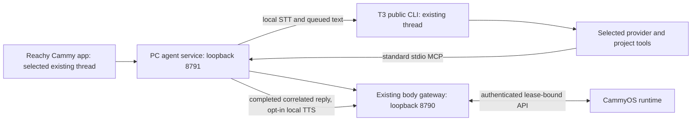

# T3-to-Cammy control implementation — 2026-11-16

> **2026-11-16 update:** under [PLAN.md](PLAN.md) the `cammy-agent` service and MCP
> tools stay as Cammy's tool layer for the Pipecat/Gemini Live host. The T3 thread
> bridge, the Reachy app panel and the spoken-T3-turn acceptance described below are
> parked until the later T3 hand-off tool.

Cammy now has a resident PC control service, standard MCP tools, a supported T3
CLI adapter and a T3 panel in its official Reachy app. The service starts idle.
Playback is blocked by Adam's overnight quiet policy. The full spoken,
project-aware conversation remains the next hardware acceptance test.

## Implemented path



The CLI sends text only. It has no image-attachment flag in the installed build.
The selected vision-capable agent calls `cammy_frame` to receive actual JPEG
image content, with freshness, boot, sequence and synthetic metadata. This does
not send every video frame to a model. A text-only provider must acknowledge that
limitation. External T3 MCP OAuth/image attachment is an optional later route;
the current adapter does not borrow provider credentials or touch T3's database.

The Reachy reference daemon still represents simulated Reachy hardware. The
Cammy app, media extension and these named tools supply the actual Cammy path.
Full Reachy body/pose equivalence and browser WebRTC duplex are not implemented.

## Components and contracts

| Component | Implementation |
| --- | --- |
| Shared finite device owner | `host/cammy_agent_core.py`; explicit 5–90 second sessions, optional sensing, epoch invalidation and bounded cleanup |
| Local service | `host/cammy_agent_service.py`; loopback-only HTTP, private bearer, strict narrow schemas and actor/session binding |
| MCP server | `host/cammy_mcp.py`; official Python MCP SDK 2.3.0, standard stdio transport, tested legacy and current handshakes |
| CLI/client | `host/cammy_agent_cli.py`, `host/cammy_agent_client.py`; same API and ownership rules |
| T3 transport | `host/cammy_t3.py`; installed public `thread list/show/send --json`, text on stdin, queued sends into existing threads |
| Thread coordination | `host/cammy_thread_bridge.py`; explicit destination, durable request receipt, run correlation and optional short reply output |
| Reachy integration | `host/cammy_reachy_agent.py` plus `cammy_reachy_app`; authenticated server-side proxy, thread/session/camera/utterance/reply panel |
| PC management | `tools/install_agent_control.py`, `scripts/systemd/cammy-agent.service`; existing `cammy-host.service` reused |

Nine MCP tools are available: `cammy_status`, `cammy_device_status`, `cammy_open`,
`cammy_frame`, `cammy_pan`, `cammy_face`, `cammy_say`, `cammy_listen`, `cammy_stop`.
Every tool supports an explicit `thread_id`; ambient thread environment is only
a convenience. Thread ID binds routing, while the private service credential is
the local authentication boundary. This is a trusted local-agent service, not
multi-user authorization based on a secret thread UUID.

Pan uses bounded renewable left/right holds, with release in cleanup. It does
not claim an absolute angle or confirmed physical movement. Speech is camera-only
bounded mono16k PCM; there is no automatic P15 fallback. Local STT/TTS are reused
from the existing conversation implementation. No cloud inference is required
for this adapter and no paid call was made during overnight development.

## Turn delivery and cancellation

The caller supplies a stable 32-hex request ID. A private durable outbox records
it before send. Repeating the same ID/content returns its receipt; different
content is refused. Ambiguous delivery is retained without automatic retry.
An acknowledgement is not a completed answer. Polling accepts assistant text
only for the acknowledged run, with completed/settled state and no active run.
Busy, queued, waiting, failed and missing-reply states remain distinct.

Only the current matching session/epoch can play its result. Spoken excerpts
are opt-in, bounded and consumed before playback so a lost HTTP acknowledgement
cannot replay them. Stop invalidates delayed synthesis, transcription and queued
chunks. Device Stop does not cancel T3 coding work already delivered. A release
acknowledgement does not prove acoustic cutoff or physical cleanup.

The UI opens a finite 60-second sensing session and captures an explicit
three-second utterance. During that window the live microphone stream is active;
this is not hardware record-button PTT, VAD or indefinite ambient conversation.
If a T3 task outlasts the window, its task/history remains in T3 and its reply
cannot speak into a replacement session. Closing the app stops sessions that
app opened; closing a browser tab relies on the finite window/lease fallback.

## Quiet operation and installation

`private/agent-control/policy.json` is owner-only and currently `quiet: true`.
Missing, malformed, symlinked, wrongly owned or wrongly permissioned policy files
also mean quiet. Both direct speech and thread-reply output check it before
model/device access; playback completion polling cancels if it becomes quiet.
No MCP or browser operation can disable it. Leave it enabled until Adam resumes
audible testing. No audio was played during this overnight milestone.

The isolated venv, dependency lock, logs, receipts and outbox live under LAB.
`cammy-agent.service` is enabled and starts idle on loopback8791. The existing
`cammy-host.service` remains the body gateway on8790. Codex's supported stdio MCP
registration points to the project entry point, with optional thread environment
passthrough; credentials are loaded privately and are absent from MCP config.
Fresh/reloaded provider sessions discover that registration. The current tool
inventory is not claimed to hot-reload. Other providers can use the same standard
stdio command through their supported MCP configuration.

```json
{
  "command": "<projects>/Cammy-OS/private/agent-control/venv/bin/python",
  "args": ["<projects>/Cammy-OS/host/cammy_mcp.py"]
}
```

To inspect without sensing:

```sh
systemctl --user status cammy-agent.service cammy-host.service
PYTHONPATH=host:sdk:. private/agent-control/venv/bin/python host/cammy_agent_cli.py status
```

Run commands from the canonical Cammy-OS repository. Installation can be reviewed
or repeated with `tools/install_agent_control.py`; it preserves unrelated MCP
entries. Stop/disable only `cammy-agent.service` to remove this service from
startup, and remove only its `cammy` MCP entry if desired. Keep the existing body
gateway/reference installation independent. Private receipts contain local
configuration and must not be committed or printed.

## Evidence

The integrated local suite passed **72 tests**, covering controller ownership,
late-result rejection, quiet policy, transcript silence, protocol handshakes,
actual stdio subprocesses, fresh JPEG tool results, T3 fake CLI/outbox, Reachy
proxy and SDK → gateway → portal speaker forwarding with a synthetic player.
Six new regressions cover reply consume-once, pending/expired refusal, quiet
before claim, Stop between chunks and speaker completion/quiet/timeout behavior.
No test in that suite establishes audible hardware output.

The actual Reachy runtime passed its separate **60-test** regression suite.
These suites overlap; their counts are not additive. Exact logs
are in `private/agent-control/final-night-tests.log` and `reachy-regression.log`.
The command for the integrated suite is:

```sh
PYTHONPATH=host:sdk:. private/agent-control/venv/bin/python -m unittest \
  tests.test_agent_control tests.test_cammy_mcp tests.test_t3_adapter \
  tests.test_thread_bridge tests.test_reachy_agent_proxy \
  tests.test_speaker_gateway tests.test_host tests.test_cammy_live \
  tests.test_cammy_control tests.test_speaker_api
```

A silent real M105 test ran the frozen RC2 portal temporarily in RAM, forwarded
its loopback port over USB, then used the official stdio MCP client to acquire
and release a control-only lease. Status worked, quiet speech was rejected and a
frame request without sensing was refused. Boot/native/watchdog identities,
stock hashes, mixer state, PCM/capture state and mounts were unchanged afterward.
All temporary camera files, processes and forwards were removed. No audio,
camera capture, head motion, radio change, firmware write or reboot was requested.
Receipt: `private/agent-control/silent-smoke.json`.

Earlier physical USB “Hello world” acceptance remains valid separate evidence;
it does not prove this Wi-Fi speaker API or simultaneous audio/video operation.

## Morning acceptance and remaining limits

1. Put the staged TF back into Cammy. Review the exact RC2 bootstrap transaction
   and perform one deliberate user power cycle. The card is currently absent
   from the camera; its USB stock boot has no home-Wi-Fi runtime. No overnight
   firmware/init change or reboot was made.
2. With Adam ready, resume audible testing explicitly. Verify camera speech over
   home Wi-Fi, Stop/expiry/cancel and mixer cleanup, then overlap video/mic/output
   and measure echo. No P15 fallback should conceal a camera failure.
3. Reload a supported provider session so it discovers Cammy MCP. Select an
   existing vision-capable T3 thread. Test three spoken project-aware follow-ups
   with a newly changed object; verify actual thread text, fresh frame tool,
   context retention and Cammy's spoken reply. No real T3 send was performed
   overnight, so this full loop is not yet accepted.
4. Then extend follow-up windows, physical record-button PTT/Robot GUI, VAD/AEC,
   interruption and browser return audio. Optional GPT-Live remains independent
   of T3 vision/tools; full duplex is not supplied by this finite-turn adapter.

RC2's frozen candidate and TF checksums are unchanged. This PC addon is newer
than its bundled desktop source snapshot. Revalidating a source-bound RC2 receipt
against today's edited checkout can report stale source; that is distinct from
changing the stored package. Preserve its build-time receipt, and package a new
release only after the current hardware acceptance.

## Supported interfaces used

- [Official MCP Python SDK](https://py.sdk.modelcontextprotocol.io/get-started/),
  [media results](https://py.sdk.modelcontextprotocol.io/servers/media/) and
  [client transports](https://py.sdk.modelcontextprotocol.io/client/transports/).
- [Codex MCP configuration](https://developers.openai.com/codex/mcp/).
- Installed T3 CLI help and `apps/server/src/cli/thread.ts` in its local source;
  [T3 outside-agent integration](https://github.com/pingdotgg/t3code/blob/main/docs/user/outside-agents.md).

These interfaces were inspected during implementation; hardware acceptance is
limited to the specific evidence above.
