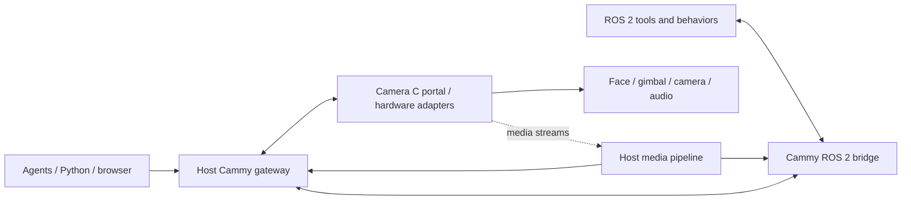

# CammyOS control plane decision — 2026-11-13

## Goal and decision — revised2026-11-15

Adam selected the **actual Reachy Mini Control desktop app and its SDK/daemon/media
contract** as Cammy's primary PC compatibility target. The earlier ROS2-first
research decision is superseded for product delivery; ROS2 remains an optional
host-side interoperability adapter. Keep the compact authenticated Cammy portal
as the internal body protocol, translated by the PC compatibility layer.

[The pinned reference, one-to-one mapping and OS upgrade plan](REACHY-COMPATIBILITY.md)
now guide implementation. Official upstream software is the reference; no full
Cammy bridge or universal hardware compatibility is claimed. Unsupported Reachy
joints, measured pose, sensors and firmware actions must be explicitly unavailable.

## Primary operating mode: wireless desk companion

Adam clarified that Reachy Mini Wireless-style use is the end goal: leave the camera on a desk with USB supplying power, then have a local bot connect over Wi-Fi. USB FEL/debugging is a development/recovery route, not a production dependency. The first usable product must work without a PC USB data session or an active chat turn.

CammyOS must start its network/control service unattended, show a useful idle face, advertise identity/capabilities and retain local hardware limits. A resident Cammy host service on the PC discovers/reconnects to the body, owns media/perception and agent orchestration, and routes commands. That host service is required for the proposed host-run bot; the ROS 2 adapter is an optional interoperability surface, not a prerequisite for everyday operation. Provider-specific model integrations attach above the gateway.

Joining the existing home LAN automatically is the preferred network mode; the verified AT-M105 direct AP is the fallback. Station-mode startup, short-link reassociation, AP fallback and charger-only control have since passed hardware acceptance; see HOME-WIFI.md. The remaining companion work is in FULL-FEATURE-ROADMAP.md. A TF boot stub entering FEL alone does not implement this unattended Linux/network startup.

The camera has 16 MiB internal flash, a vendor ARMv7/musl Linux stack and a verified compact C portal. Put ROS 2 dependencies, media conversion, AI and app management on RED-LINUX. Camera-local control owns hardware limits, timeouts, explicit sensing state and disconnect behavior. Reconsider a native micro-ROS/XRCE client only if the simpler body link becomes a measured limitation.

## Projects reviewed

| Project / interface | Verified architecture | What Cammy should reuse |
|---|---|---|
| [ROS 2](https://github.com/ros2/ros2) | Robot libraries/tools, client APIs, typed graph interfaces and a package ecosystem | Host-side integration, standard sensor/joint interfaces, recording and diagnostics |
| [Reachy 2 core](https://github.com/pollen-robotics/reachy2_core) | ROS 2 workspace containing robot description, controllers, bring-up, simulation and fake hardware | Separate hardware adapter from standard robot description and reusable host behaviors |
| [Reachy Mini API](https://github.com/pollen-robotics/reachy_mini/blob/main/docs/source/API/rest-api.mdx) | Resident daemon with HTTP/WebSocket API; Lite daemon runs on host, Wireless daemon on robot | Host daemon + accessible API, app lifecycle, capability/state reporting; optional source-level behavior adapter |
| [micro-ROS Arduino](https://github.com/micro-ROS/micro_ros_arduino) | ROS 2 client support for supported Arduino MCU boards through a micro-ROS agent | Future auxiliary MCU integration if needed; not a ready M105 board port |
| [Arduino Firmata](https://github.com/firmata/protocol) | Host-to-MCU protocol, with GPIO, I2C, servos and other extensions and clients in several languages | Optional future Arduino accessory bridge; too low-level as the whole camera/audio/face/motion control plane |

Reachy Mini's current maintainer notes say Zenoh was removed in v1.5.0; current transports are JSON-RPC over WebSocket/WebRTC data channels. Older articles about its Zenoh daemon should not drive this implementation. [Maintainer update](https://github.com/pollen-robotics/reachy_mini/issues/677). Reachy 2's ROS 2 architecture and Reachy Mini's simpler application API are distinct designs.

## Runtime layout

The gateway is the shared control authority for HTTP and ROS clients. Every actuator path must honor the same ownership/expiry/stop rules; a ROS subscriber must not bypass the lease. Camera-local watchdogs remain authoritative if the host disconnects. The current device shared-token/agent-name mechanism is cooperative ownership for trusted clients; per-client identities belong in the gateway. Keep the initial ROS graph host-local or in a deliberately configured trusted domain. A USB cable is only a transport once Linux provides a gadget/debug/network endpoint: ROM FEL is a boot/recovery tool, not the robot's running control plane.

## Initial ROS interface map

These are planned public mappings, not advertised working endpoints.

| Body function | Preferred ROS 2 interface | Gate before exposing |
|---|---|---|
| Camera image | `sensor_msgs/msg/Image` plus `image_transport`; JPEG/PNG can use `sensor_msgs/msg/CompressedImage` | Decode H.264 on host; do not label raw H.264 packets as conventional JPEG CompressedImage |
| Calibration | `sensor_msgs/msg/CameraInfo` | Measure calibration; do not invent intrinsics |
| Gimbal state | `sensor_msgs/msg/JointState` with named pan/tilt joints, radians | Establish feedback, zero positions and signs; distinguish estimates/commanded positions from measurements |
| Gimbal trajectories | `control_msgs/action/FollowJointTrajectory`, with a later `ros2_control` hardware interface if justified | Measured travel/velocity limits, timeout/stop, cancellation and honest completion feedback |
| Health | `diagnostic_msgs/msg/DiagnosticArray` | Define freshness and failure semantics |
| Stop | `std_srvs/srv/Trigger` or equivalent gateway operation | Same authoritative stop path for every client |
| Face and speech | Small versioned Cammy service/action definitions initially | Document unsupported expressions; define playback/cancel/finish semantics |
| Audio | Select a maintained ROS audio interface after capture/playback format and timestamps are verified | No claim that one universal core ROS audio standard exists |

Use REP-103 conventions (SI/radians and explicit frames) and a simple measured URDF. Do not model Reachy's six-axis head, antennas or body yaw when the camera lacks them. A compatibility shim must report missing capabilities and map only meaningful gaze/expression operations. It must not pretend to be a complete Reachy device.

ROS message header timestamps describe acquisition time. The current RTSP probe does not establish exposure-clock synchronization; record that limitation, carry host receipt time separately, and do not silently present receipt time as a measured exposure timestamp. Shared-token agent labels likewise must not be presented as independent authorization identities.

## Implementation order and acceptance

1. Build real media and actuator adapters on the verified stock-kernel/TF startup. Keep the direct portal/SDK contract working; full replacement OS boot is a separate track.
2. Extend the existing resident host gateway with media ownership/subscriptions, diagnostics and the companion runtime.
3. Add a ROS 2 bridge using standard messages, a measured URDF, and a mock body for development. Verify discovery, lease conflicts, stale telemetry, disconnect stop and unsupported capabilities with the mock before hardware tests.
4. Demonstrate a ROS image subscriber/recording and a bounded pan/tilt action on real hardware; ensure browser/agent and ROS clients cannot fight over the robot.
5. Add narrowly scoped Reachy-style behavior helpers and optional Firmata/micro-ROS accessories only when a concrete application needs them.

Completion of research selects the architecture and interfaces. It does not establish installed ROS 2 support, a working bridge, or full robot operation. Pin ROS distribution/runtime versions when the host adapter is actually built, based on its supported host OS; do not install Rolling or a large robotics stack onto the camera by default.

## Primary interface references

- [ROS 2 common sensor messages](https://github.com/ros2/common_interfaces/tree/rolling/sensor_msgs/msg), including [JointState](https://github.com/ros2/common_interfaces/blob/rolling/sensor_msgs/msg/JointState.msg) and [CompressedImage](https://github.com/ros2/common_interfaces/blob/rolling/sensor_msgs/msg/CompressedImage.msg).
- [FollowJointTrajectory definition](https://github.com/ros-controls/control_msgs/blob/master/control_msgs/action/FollowJointTrajectory.action).
- [ROS REP-103 coordinate and units conventions](https://www.ros.org/reps/rep-0103.html).
- Project sources linked in the comparison table, checked on 2026-11-13.
