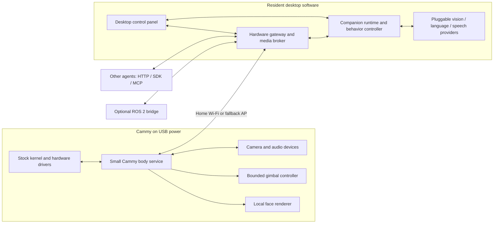

# CammyOS full companion roadmap — draft

**2026-11-15 revision:** [0.5.0 automatic boot and live A/V are accepted](../COLD-BOOT-AV-2026-11-15.md).
The primary PC target is now the actual [Reachy Mini Control/SDK/daemon contract](REACHY-COMPATIBILITY.md),
not a new standalone Cammy console. The detailed compatibility mapping and bounded
face/display proof govern the next packages; older starting-point entries below
are historical constraints rather than current media availability.

**Priority correction2026-11-15:** Adam approved [sustained live media](LIVE-MEDIA-MILESTONE.md)
as the next delivery. The PC must receive video and enabled-session microphone
audio while they are produced, followed by simultaneous arbitrary speaker output.
Record/finish/download/transcribe is a diagnostic workflow, not the product.
The Wi-Fi console, more button mapping and framework work are secondary to this.

Date: 2026-11-14 UTC. Owner: Adam. This is the current draft for the remaining companion work. Networking acceptance is complete; remaining milestones below are proposed, not implemented capabilities. It supersedes the earlier companion implementation sequence while preserving the control-plane decision in [CONTROL-PLANE.md](CONTROL-PLANE.md).

## What “full features” means

Cammy should be a desk companion that stays powered by USB, joins home Wi-Fi, presents an animated face on its own screen, looks around through its real motorized gimbal, and has natural two-way spoken conversations. A resident local agent can see and hear when observation is enabled, react physically, remember useful context, and continue between chat sessions. Other authorized agents can use the same body through a documented interface.

A complete demonstration is: power on; Cammy becomes available with no Wi-Fi-menu input; ask “look left” and the real gimbal turns; ask “what am I holding?” and the answer uses a fresh frame; speak naturally and interrupt its reply; its voice, face and gaze stay coordinated; close the chat window and it keeps working; mute/stop controls and network recovery work throughout.

“Full” has three delivery levels:

| Level | Required outcome |
|---|---|
| Body ready | Home-network vision, working microphone/speaker transport, real bounded gimbal movement, screen face, reliable SDK/control panel |
| Conversation ready | Resident agent, useful visual context, intelligible natural voice, turn-taking, genuine full-duplex interruption, coordinated expressions/gaze |
| Daily companion ready | Ambient modes, deliberate proactive behavior, usable settings, independent agent access, startup/reconnect, maintenance/rollback and a loaded full-day endurance test |

A new source-built kernel or fully replaced firmware is a separate engineering track. Its feasibility is still unresolved, and it does not need to gate these body/companion milestones.

## Starting point: measured evidence

| Area | Verified | Remaining gap |
|---|---|---|
| Wireless/power | Automatic home Wi-Fi startup; authenticated control; short-link reassociation; CammyOS AP fallback; charger-only cold operation for over12minutes; native idle shutdown disabled | Full-day endurance and improved recovery after a failed/interrupted startup; AP currently stays AP until restart |
| Desktop software | Enabled resident `cammy-host.service`, local endpoint `127.0.0.1:8790`, reconnect and authenticated proxy | Media broker, companion runtime, events, control panel and agent adapters |
| Camera | A640×480 frame decoded through the stock AP/RTSP/event route in an earlier test | Home-network video, continuous transport, timestamps/freshness and recovery |
| Microphone | Actual16kHz mono ALSA PCM captured after enabling MIC1 | Intelligible continuous capture, desk-distance quality, duplex and echo handling |
| Speaker | ALSA accepted a short low-volume waveform | Audible confirmation, clean speech, calibrated volume and continuous playback |
| Gimbal | Native startup movement; motor/MCU/UART and app-control paths identified | Agent-requested movement, exact protocol, actual axes, limits, stop, feedback and arbitration |
| Screen | Framebuffer read; one measured mode356×400 with356×800 virtual storage | Recheck current format/stride/orientation; control the face without breaking the vendor media app |
| Recovery/OS | Full flash backups; TF-to-FEL entry; matching full-chip reads; custom userspace executes | Flash restoration/programming and full replacement OS boot remain unverified |

The current portal's face, motion, capture and speech adapters are not implemented. Nonzero microphone samples do not establish good speech capture, and a successful playback return code does not establish audible speech. Exact current acceptance: [HOME-WIFI.md](../HOME-WIFI.md), [VALIDATION.md](../VALIDATION.md), and their local evidence files.

## Architecture

**On the camera:** own hardware access, local motion limits/timeouts, PCM capture/playback, face rendering and truthful health/capabilities. Keep heavy inference and large dependencies on the PC. Preserve the working stock media stack initially. The vendor app owns a hardware watchdog and several hardware paths; replacing its UI cannot casually mean stopping the whole app.

**On the PC:** extend the existing gateway into a media owner/broker. Add a separately supervised companion runtime for perception, dialogue, tools and behavior. An agent crash should not take down the gateway, leave a motor command running, or leave old speech queued. Use bounded media queues and session generations so reconnecting cannot replay stale commands/audio.

**Desktop service: yes.** The existing service is the foundation, not yet the complete resident bot. Start with a local web control panel and optional tray shortcut. A native app wrapper can follow once the behavior is useful. Startup, media and agent operation must continue without a terminal or active T3 chat turn. Verify any Bot-container/T3 integration when implemented; no existing Cammy agent container or live integration is assumed.

Keep the selected HTTP/JSON/Python interface and add host event subscriptions/media access. Provide an MCP adapter for tool-using agents; keep ROS2 as optional host-side robotics interoperability. Every adapter shares ownership, stop and capability rules. Do not require a model provider or ROS installation for basic body access. Use local-network/T3 Connect access where appropriate; no Tailscale dependency.

The separation of media ownership from clients follows the useful daemon pattern in [Reachy Mini's media architecture](https://huggingface.co/docs/reachy_mini/en/SDK/media-architecture). Its hardware SDK is not a drop-in implementation for this camera.

## Delivery sequence

### 1. Body media and desktop gateway

First make the PC reliably receive the camera, hear through its microphone and play a spoken phrase on its speaker. This establishes the hardware paths needed by the rest of the product.

- Fix home-network camera initialization/listener access; expose fresh snapshots and a continuous stream through the gateway. Begin at the proven resolution and measure bandwidth/latency before increasing it.
- Bring up an audio broker with one owner for each PCM device. Confirm supported rates/formats and capture/playback simultaneously. The observed16kHz PCM is a starting point; advertised but unusable8kHz RTSP audio is not the quality target.
- Stream audio rather than execute ADB per chunk. Keep capture/playback sequences, timestamps, queue depth, loss/underrun counters and connection generations.
- Evaluate a lightweight body transport against CPU/latency; reuse working encoded video. Put browser/standard-client media conversion on the PC, with WebRTC a candidate for low-latency A/V distribution.
- Extend the desktop service with worker supervision, explicit start/stop, freshness, visible errors and a basic media/volume test page.

**Done:** a local client gets a fresh image, receives an intelligible10second microphone clip, and plays a phrase audibly through Cammy; then A/V runs30minutes without growing queues. Link interruption recovers, stale frames are rejected, and the body still works with USB supplying power only. Raw simultaneous input/output must be proved here, before promising natural duplex conversation.

### 2. Agent-controlled gimbal — early priority

The agent must move the actual gimbal. Animated pupils alone do not pass this milestone.

- Resolve the legitimate app-command path and existing MCU protocol. Prefer the vendor controller if usable; direct UART requires exclusive ownership. Do not have the vendor app and our service write `/dev/ttyS3` concurrently.
- Start with a very short, slow movement, stop and return. Establish which axes are powered, signs, safe center, mechanical range, speed and whether actual position feedback exists. Avoid a blind full-travel sweep or MCU firmware change.
- Expose bounded `look`, `jog`, `center`, `stop` and motion status. These are proposed operations; current endpoints do not implement them.
- If hardware only supports timed velocity control, expose bounded relative jogs and label position estimates. Do not claim measured absolute angles or unsupported tilt.
- Enforce limits, command expiry, cancellation and lost-host stop on the body. Coordinate vendor tracking, manual controls, agent requests and idle behavior through one arbiter.

**Done:** an agent issues left/right/center and stop through the normal gateway; the real camera moves predictably inside measured limits. Cancellation, lease expiry and connection loss stop movement. Video remains usable. Results distinguish measured position, estimated position and unsupported axes.

### 3. Screen becomes the face

Probe display ownership early in the body work because it could require a different approach.

- Recheck framebuffer dimensions, pixel format, stride, virtual pages, rotation and display layers on this running configuration.
- Use a local lightweight renderer for idle/blink, attentive, listening, thinking, speaking, muted and disconnected states. Initial animation target:15–30fps, subject to measurement.
- Establish a display layer or narrow UI-only intervention while preserving camera encoding, audio, motor control and the vendor watchdog. A framebuffer write that the stock GUI immediately overwrites is not a solution.
- Synchronize mouth/brightness with audio actually played, using an amplitude envelope initially and phoneme timing only when the chosen synthesizer supplies it.
- Coordinate pupil intention with physical gaze; keep a local disconnected/muted face working when the PC is unavailable. Retain a maintenance path to the stock UI.

**Done:** the animated face owns the visible screen through a complete A/V and motion session, survives reconnect, and accurately shows sensing/mute/speech state. No requirement to replace the whole OS to draw the face is assumed.

### 4. Resident conversation and agent tools

Adam's 2026-11-14 refinement makes [push-to-talk and finite listening windows](PUSH-TO-TALK.md)
the default: idle audio acquisition off, red record-button hold to wake, follow-up
conversation after release, then idle. Agents can wake a finite session; mute
still wins. VAD is a later active-window turn-boundary option. Host engagement
policy is locally implemented; record mapped to event3/code28 on2026-11-15,
but reassignment and suppression of native recording remain unverified.

Deliver a useful first conversation loop, then finish natural duplex in milestone5.

- Connect streaming recognition, a provider-neutral agent/tool adapter, and streaming speech synthesis. Compare local/cloud candidates on this PC for latency, accuracy, voice quality and operating cost before choosing defaults.
- Connect speech requests to real tools: “look left,” “what do you see?”, “stop,” and face changes. Visual answers require a fresh timestamped frame.
- Maintain dialogue state and a short recent-context buffer. Keep the behavior controller and local face responsive during slower model calls.
- Support text input/captions as well as voice. Provider credentials stay in private host configuration, not camera images or agent tool payloads.
- Initial turn-taking may suppress recognition during playback, but label that as an interim limitation. It does not satisfy the final two-way-live-conversation goal.

**Done:**20minutes of coherent turn-taking using Cammy's real mic/speaker, with visual questions and actual motor commands. The resident runtime continues when this chat closes; disconnect/provider failure is reported honestly. It has bounded queues and cancel handles rather than accumulating replies.

### 5. Voice quality and genuine full duplex

Treat capture quality, synthesized voice, speaker quality and conversation timing as separate problems.

**Capture:** measure intelligibility, clipping and background noise at approximately0.5,1and2metres. Check microphone gain/routing, desk vibration and gimbal noise. Tune high-pass/noise suppression/gain gently; preserve raw samples for short controlled comparisons. Probe higher native rates if supported. Upsampling an8kHz source does not recover missing voice detail.

**Voice:** audition several voices with identical test phrases. Evaluate pronunciation, cadence, warmth, volume, emotional range, streaming delay and persona consistency. Tune speaker gain/EQ/limiting after listening; good TTS cannot repair the physical bandwidth or distortion limits of a tiny speaker.

**Duplex:** keep the microphone active while Cammy talks. Feed actual playback PCM into an echo-reference path, align transport/playout timing and clocks, and combine echo cancellation with voice activity detection and interruption logic. User speech cancels generation, synthesis and queued audio together; stale chunks cannot resume after interruption. Benchmark while the gimbal moves as well as while stationary.

[GStreamer's WebRTC DSP](https://gstreamer.freedesktop.org/documentation/webrtcdsp/webrtcdsp.html) is one candidate for host processing. Its echo canceller requires a playback-reference probe with matching sample rate and the same top-level pipeline; correct wiring and timing must be established, not inferred from enabling a filter.

**Done:** natural back-and-forth with overlapping user speech, reliable interruption, no recurring self-conversation/feedback, comfortable intelligibility at the agreed desk distance, and measured latency. A30minute duplex trial includes at least20 deliberate interruptions and quiet/background-noise cases. Half-duplex is not the final pass condition.

### 6. Embodied attention and ambient companionship

- Add presence/visual tracking, gaze deadband/easing, conversational gestures and modest idle motion. Use only real supported axes.
- Couple face, voice and gimbal through one behavior state machine. Avoid jitter, competing commands and distracting constant motion; reduce movement if it harms microphone clarity.
- Support observing, conversation, quiet, private/muted and sleep modes. Ambient observation need not require a wake word for every event; optional addressing cues can reduce accidental interruptions.
- Run cheap continuous detection and selected-frame analysis; invoke heavier reasoning on speech, meaningful scene changes or selected awareness ticks. Begin around1–2semantic frames/second and tune to measured utility/cost, separately from video frame rate.
- Keep bounded recent A/V context in RAM. Retain selected useful memory with provenance; raw continuous recording is a separate user setting.
- Add configurable proactive speech and quiet periods. Observation should not mean narrating every movement. A single verified microphone does not establish sound-direction finding; use visual attention unless better hardware is proven.

**Done:** Cammy notices the owner, tracks within its range, relates “this” to recent visual context, responds with coordinated gaze/face/voice, and occasionally initiates useful interaction within the chosen interruption budget. Muting genuinely stops acquisition and is visibly indicated.

### 7. Desktop experience and daily-use release

Expand the basic panel alongside the milestones, then finish packaging here.

- Status: body/agent connectivity, actual capabilities, fresh preview, mic/speaker activity, current owner, faults and recovery.
- Controls: observation mode, mute, stop, volume, manual gaze/center, expression preview, model/voice configuration and captions/history options.
- Operations: start/stop/restart workers, diagnostics, stream health/latency, bounded logs/cache, versioned updates and userland rollback. Keep authentication and per-agent access manageable as more clients join.
- Improve network recovery: discovery/address changes, automatic return from AP fallback to home when feasible, and inspectable/clearable failed-start latches. Existing DHCP reservation remains useful.
- Test PC reboot/logout, camera cold boot, router outage, host/model crash, interrupted speech/motion, update failure and power interruption. Ordinary use must recover without root ADB or a chat session.
- Run a full24hour loaded endurance test with A/V, conversation and intermittent motion. Verify sustained charging, CPU/RAM/thermal behavior, reconnect counts, disk/model cache use and model-call cost.12minutes on power is the current baseline, not this acceptance.

**Done:** a day of normal desk use with no unexplained shutdown or growing queues; restart/recovery and rollback work; the user can understand/control what Cammy is doing from the face and desktop panel. Code/data stay on LAB, model downloads/caches on mounted SERVE model folders. Respect the existing model-server lifecycle and drive-temperature rules during benchmarks.

## Proposed performance targets

These are initial engineering targets, not current measurements or promises. Reassess them after the first real hardware baseline and report median/tail values rather than a single best run.

| Interaction | Initial target |
|---|---|
| Frame used for “what do you see?” | Under1second old; show uncertainty/failure instead of stale imagery |
| Live video latency | Aim for under500ms on the home LAN |
| Gimbal command to motion start | Aim for under250ms; physical travel time is separate |
| Loss-of-host movement stop | Body-local timeout around500ms or a tighter measured safe bound |
| End of user speech to first reply audio | Aim median under1.5s and95th percentile under3s on the selected setup |
| User interruption to speaker silence | Aim under300ms, including already queued playback |
| Face animation | Aim15–30fps locally; independent of model response time |
| Daily readiness |24hour loaded run, plus repeated cold-start/outage tests |

## Hardware decision gates

| Unknown | First test | If the result is insufficient |
|---|---|---|
| Motor control/feedback | Small jog/stop/center and protocol/feedback inspection | Use honest relative control; investigate the MCU path; unsupported axes remain unavailable |
| Concurrent screen/media | Render a stable test face while streaming A/V | Explore display-layer or narrow UI control; investigate deeper firmware work only if necessary |
| Mic/speaker full duplex | Simultaneous capture/playback before full agent integration | Investigate mixer/driver ownership; use PC audio only as an explicitly degraded prototype, or agree on a hardware change |
| Natural voice quality | Recorded desk-distance phrases and speaker auditions | Tune DSP/voice/output; measure hardware limitations before proposing purchases |
| Sound direction | Verify usable channels/microphone geometry | Do not claim direction finding from a single channel; visual gaze or optional extra hardware |
| Power/endurance | Loaded24hour operation on intended supply | Diagnose charging/thermal/policy problems before claiming daily readiness |

External PC audio or a virtual gimbal can accelerate development, but neither silently counts as completing the camera-body requirement. No new purchase is assumed. A purchase/physical modification becomes a decision only if a measured hardware limitation blocks the requested experience.

## Agent and robotics interfaces

Extend the existing versioned API with fresh-frame/stream access, audio subscriptions, playback jobs/cancellation, bounded motion, face state, observation mode and health events. Proposed conceptual calls include `observe(max_age)`, `listen`, `speak`, `look`, `center`, `set_face`, `set_mode`, `stop` and event subscription. These names are design intent, not claims of installed endpoints.

Use one authoritative ownership and stop path across HTTP/Python, MCP and ROS clients. Distinguish cooperative agent labels from independently authenticated identities. Read-only observers can share media; actuator conflicts must be resolved consistently. Add ROS mappings for measured joint state/trajectories and standard image/diagnostic messages when the adapters exist, following [CONTROL-PLANE.md](CONTROL-PLANE.md). Do not imitate Reachy's unavailable axes/antennas or advertise compatibility that has not been tested.

[Reachy's conversation application](https://github.com/pollen-robotics/reachy_mini_conversation_app) is a reference for separating conversation, tools and motion/media integration. Pin inspected versions and licenses before copying code; its robot-specific assumptions require an adapter.

## Separate firmware/OS track

Keep full-flash work separate from the companion critical path. It can proceed when a concrete limitation warrants it: prove restoration/programming through the verified FEL route; produce/read back a board-matched stock-derived image; verify boot and rollback; only then investigate replacing more of the BSP/kernel. Existing RAM-kernel launches did not boot successfully. A source-built OS requires exact board/DRAM/power/display/media support; no generic image is promised.

The first daily-use Cammy can use the proven stock kernel with CammyOS services and a face/controller. Consolidating those services into a recoverable internal installation is useful later, but “new OS flashed” does not substitute for working gimbal, voice or conversation.

## Immediate implementation slice — revised2026-11-15

Start and pin the official Reachy Mini control/SDK reference. Map its actual
control, state, media and application interfaces to Cammy's supported subset.
Next implement a PC compatibility/media adapter so the official surface and an
upstream SDK client consume real fresh Cammy frames and microphone PCM from one
managed session. Add the camera-local bounded Wi-Fi input guardian and a separate
short physical face/rendering proof, then integrate these under the same control
and Stop authority. Real speaker streaming remains a separate hardware gate.
See [work packages and acceptance](REACHY-COMPATIBILITY.md).
