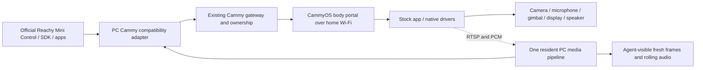

# Reachy Mini as Cammy's PC compatibility target

Decision: Adam,2026-11-15. The end product should connect to the actual open-source
Reachy Mini PC control surface and SDK/daemon interface. A separate Cammy-only
console is no longer the primary target. This names a concrete upstream contract,
not a claim that every robot shares one industry-standard API.

## Pinned reference

- Official desktop: Reachy Mini Control0.9.38, upstream commit
  `866cf3a090b11b382e653963c2da16dd12c8ff85`.
- Official SDK/daemon: Reachy Mini1.14.0, upstream commit
  `c825877381a2f610e1acd6152b84fbf397655050`.
- Both source licenses are Apache2.0. Sources, installed app, private Python
  environment and application data live under
  `<projects>/Reachy-Mini-Control/`.
- The reference daemon uses upstream mockup simulation with media disabled.
  It must never be presented as connected Cammy hardware. The desktop's optional
  BLE plugin catches its NoAdapters exception on this host; it does not establish
  Bluetooth support. Cammy uses home Wi-Fi.

The official [REST/WebSocket reference](https://huggingface.co/docs/reachy_mini/API/rest-api)
and [media architecture](https://huggingface.co/docs/reachy_mini/en/SDK/media-architecture)
were checked on2026-11-15. Reachy's daemon provides HTTP/WebSocket control and
remote WebRTC media; its Python SDK exposes media access and robot controls.
The desktop and SDK releases above are the executable contract baseline.

## Running reference on this PC

**Installed and running:** the official desktop window was confirmed by Adam.
The unmodified1.14.0 daemon runs at `http://127.0.0.1:8000`, named
`cammy-reference-simulator`, using `--mockup-sim --no-media`. The app offers
“External daemon detected on localhost:8000”; choose **Connect** to use this
reference. This is simulated Reachy hardware with no media, not Cammy control.

REST daemon/name/full-state requests, one state WebSocket message, and a genuine
upstream Python SDK connection passed. The SDK read a4×4 head pose, set simulated
body yaw to0.1rad, observed it and restored0.0rad. No camera or real motor was
involved. [Provenance](../reachy/reference-provenance.json) pins the source/assets and
results; the interface inventory is derived from its actual OpenAPI/source.

The SDK uses a private Python3.12.16 environment. Its required PyGObject3.46.0 and
Pycairo1.29.2 were built with downloaded/extracted Ubuntu development packages in
`runtime/gi-sysroot`; no sudo/system package installation or upstream source
patch was needed. The final dependency check passed for73 packages. App data,
config and caches remain under the LAB workspace; model/HF caches point to
`SERVE/models/huggingface`. No HF sign-in is required for this local reference.

Start/reuse it with:

```sh
python3 <projects>/Reachy-Mini-Control/launch_reference.py
```

`--status` checks the live reference, and `--daemon-only` starts/reuses just the
reference API. The launcher refuses a different service on port8000. The desktop
and reference daemon are intentionally left running at Adam's request. Existing
Cammy gateway8790/body8787 remain separate and unchanged.

## Implemented first extension: ParamFace and live media

`cammy_reachy_app` is now discovered and launched by the official app manager,
with its settings page at127.0.0.1:8801. It uses upstream `ReachyMiniApp` lifecycle
with `request_media_backend=no_media`, keeps simulated Reachy poses separate,
and opens real Cammy media only during explicit finite sessions. ParamFace and
its existing HTTP editor contract provide the host face preview. Actual expiry
and app-manager Stop both returned real camera sensing to idle/CLOSED. See
[implementation and measured results](PARAMFACE-REACHY-LAB.md).

The follow-up [receive-only SDK/WebRTC media extension](REACHY-MEDIA-2026-11-15.md)
now interoperates with the upstream media classes and passes actual camera/Stop
trials. This remains an app/SDK extension, not a complete Cammy-compatible Reachy
body daemon or automatic `ReachyMini(...).media` backend. The
legacy companion must also be connected to the new live providers explicitly.

## Target architecture



The real upstream simulator is a separate reference process, not the adapter in
this diagram. The full body adapter is not implemented yet; the app extension above is its
first real-media integration. Keep heavy Reachy dependencies,
WebRTC conversion and inference on the PC; the512MiB ARM camera retains compact
CammyOS C services and its working stock drivers. USB is for power in production.
ROS2 remains an optional secondary bridge, not the primary PC surface.

## One-to-one mapping approach

The structured inventory is [control-map.json](../reachy/control-map.json), with31
mapping groups. The pinned daemon exposes80 HTTP paths/83 operations; the
[route inventory](../reachy/route-inventory.json) maps every operation and8
source-declared WebSocket routes. Only REST/state and SDK/state WebSockets have
been exercised live; source inventory is not implementation or acceptance.
Every upstream surface has a Cammy destination or an explicit unsupported result.
The adapter may translate protocol, units and media format; it must not fabricate
extra joints, measured pose, audio playback, microphone-array direction or a
successful firmware update. Existing Cammy physical evidence is narrower than
Reachy's complete hardware model.

- **Device/status/state:** identify Cammy as an M105 body with boot identity and
  capability/freshness metadata. Unsupported pose/state fields remain unavailable.
- **Vision:** adapt the proven RTSP source to the SDK's frame interface and
  desktop WebRTC path. Decode once, fan out to UI and agent, and retain only a
  bounded timestamped latest-frame/history buffer during observation. The surprise
  test exposed why packet counters cannot substitute for agent-visible pixels.
  Prefer the SDK's WEBRTC backend initially, including for clients on this PC.
  Its LOCAL backend opens a PC audio device directly: publishing a camera IPC
  endpoint prematurely could select P15/default PC audio instead of Cammy. Do
  not advertise local media until both image and audio sources are correctly
  backed by Cammy. Unknown camera intrinsics must not silently become Reachy
  camera calibration; image/world gaze remains blocked pending the body profile.
- **Listening:** adapt the real16kHz mono PCM stream to declared SDK input format.
  SDK microphone recording means a live subscription, not native TF recording.
  The existing companion's legacy `/v1/audio/capture` contract must be replaced
  with a live provider adapter; changing a capability flag alone is insufficient.
- **Motion:** only the observed pan axis can become a head-yaw mapping. Wi-Fi
  key-hold/release and a local release guardian must come first. Absolute pose,
  image/world gaze, trajectories and stock Reachy dances stay blocked until
  calibration/feedback and semantics are verified. Report estimates as estimates.
- **Speech:** the SDK output stream needs a real cancellable Cammy PCM playback
  backend. Playing an existing TF video or using the P15 is not that backend.
- **Face:** Reachy Mini has no equivalent M105 LCD face API. Add a named Cammy
  extension or upstream-style app panel under the same control/session system.
  Do not reinterpret antenna values silently as eyes or claim native compatibility.
- **Apps/update/power:** manage approved applications on the PC. Never forward
  Raspberry-Pi/Reachy firmware installers, reboot requests or generic scripts to
  M105. Restarting the PC adapter must not restart the watchdog-owning stock app.

The pinned desktop's `AudioVisualizer.tsx` describes its FFT display as simulated;
animated bars are not microphone evidence. The adapter must expose real measured
levels if that UI is used to demonstrate Cammy audio.

The desktop also has Tauri-native BLE/SSH/provisioning/update commands outside
the daemon OpenAPI. The Cammy profile must gate those UI paths explicitly; an
HTTP adapter alone cannot block them. Raw actuator-register passthrough stays
unavailable. A display-name change must never trigger an AP SSID/radio change.

Use the same lease/Stop authority across SDK, UI and agent clients. Keep the
reference's unauthenticated interface loopback-only; the real body token remains
private in the existing gateway. Multiple viewers share a managed media session
rather than creating competing native owners. Reject stale commands after Stop,
reconnect or boot change. Disable unsupported controls visibly in any necessary
upstream UI adaptation instead of returning invented success.

## Next outcome-sized work packages

1. **Reference and executable contract (this task).** Run official desktop and
   mockup daemon, save its API identity/spec hashes, and verify an upstream SDK
   request. Finish the mapping inventory and record all missing physical features.
2. **Cammy media inside the Reachy surface.** Implement a PC adapter using the
   existing gateway, timestamped latest frames and live PCM. Add the upstream
   WebRTC/signaling/SDK contract locally. Acceptance: the official surface and a
   stock SDK client both receive real Cammy media, and an agent answers a surprise
   scene question from a frame already available to that session. Stop/disconnect
   ends subscriptions and returns native capture to CLOSED. No manual Wi-Fi UI or
   per-action USB scripts. This is the next integration leap.
3. **Wi-Fi motor control through the same authority.** Port the proven evdev
   hold mechanism into a small TF body helper with independent expiry/key-up.
   Integrate controlled pan/jog and native turnaround. Test release in mid-travel,
   not just at an end stop. Only then map supported upstream target commands.
4. **Real face proof, then face integration.** Perform the bounded display work
   below, expose expression state through the same adapter, and tie it to actual
   idle/listening/thinking/speaking/muted/disconnected state. A successful browser
   animation or stock image viewer alone does not complete this outcome.
5. **Conversation and body voice.** Connect the existing engagement/companion
   logic to real streaming providers and upstream-compatible media. Desktop PTT
   can exercise policy first; the physical red record button requires suppression
   of its stock recording action without capturing the shared power-button bank.
   Prove real Cammy speaker output/cancellation, then duplex/echo handling.

These are delivery packages, not permission requests. They keep product integration
moving while each physical capability remains independently evidenced.

## Bounded physical-screen work

Known: stock `sdvcam` owns `/dev/fb0` and `/dev/disp`; one measured framebuffer
mode is356×400, virtual356×800,32bpp, stride1424. Native UI/media libraries exist.
Read-only framebuffer queries now confirm BGRA channel fields. Offline native
image emulation establishes the12-byte vendor header and direct pointer offsets;
see [native face ABI findings](../NATIVE-FACE-ABI.md). Still unknown: the owned UI
surface/layer, full object/cache lifetime and teardown, rotation/coexistence and
guarded activation.

First map the native UI/render hook or a documented free display layer from the
saved executable and read-only live metadata. Choose a CammyOS renderer that owns
that surface through a typed hook. Do not paint raw VRAM, race stock framebuffer
updates, stop `sdvcam`, or guess display ioctls. If an in-process change is
required, return to the existing ABI/activation review; do not hide it in a TF
update or make that investigation block the PC reference/media adapter.

Prepare a10s trial: neutral eyes, one blink, normal view restoration on timeout,
Stop and disconnect. Adam must see the face on the physical LCD while fresh video
and microphone data continue arriving. Inspect native owner/health and verify
cleanup afterward. A fallback still-image viewer can demonstrate the LCD, but if
it stops live media it remains a diagnostic rather than an accepted robot face.

## OS and host upgrades implied by the target

- Keep accepted0.5.0 automatic station/shared-audio/native-media startup.
- Add a camera-local bounded input/Stop guardian and truthful input/motion state.
- Add only a proved display renderer and finite/cancellable PCM output backend.
- Extend capability/health reporting with boot, session, ready/unavailable and
  freshness data. Leave unavailable controls unavailable until their tests pass.
- On the PC, add the Reachy compatibility layer, one media manager, SDK/desktop
  integration, agent frame/audio providers, and resident reconnect behavior.
- Package body changes through the backed-up TF workflow. Full flash/kernel work
  is a separate project track, justified only by a measured missing capability.

A first useful subset is media + session control + bounded pan + face state. Full
Reachy hardware equivalence is impossible for this body; compatibility must be
explicit about the supported subset and Cammy-specific extensions.
