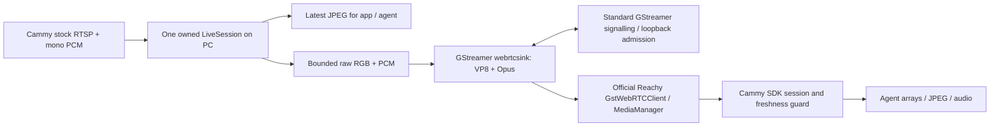

# Real Cammy media in the Reachy SDK — 2026-11-15

The official Reachy media classes now receive real M105 video and microphone
through WebRTC. The installed Cammy Reachy app publishes during explicit finite
sessions; a receive-only SDK extension adds session/freshness/Stop handling.
The camera retains its accepted0.5.0 runtime, stock app, kernel and drivers.

This closes the SDK **media** integration gap. The reference robot daemon still
represents simulated Reachy hardware. A complete Cammy-backed daemon, automatic
`ReachyMini(...).media` selection and the desktop's generic camera tab are not yet
implemented. Cammy's app page continues to show real camera JPEGs independently.

## Measured hardware evidence

| Trial | SDK video | SDK audio | Cleanup |
| --- | --- | --- | --- |
| First10s receive interval |47 frames/46 changed transitions|147,200 float sample frames|Stop emptied SDK output; owner released; ALSA capture CLOSED|
| Final5s receive interval, explicit receive-only transceivers |23 frames/21 changed transitions|73,280 float sample frames|SDK/bridge stopped; owner null; preview off; driver CLOSED|

Audio is16kHz and two identical float32 channels, adapted from the **one real
Cammy mono microphone**. The final trial counted146,122 nonzero float values;
maximum channel difference was0. It does not imply a stereo microphone array.
First decoded video arrived2.484s after the start request, audio at2.151s, including
startup and negotiation. These are startup measurements, not end-to-end latency.
No new speech-intelligibility or camera-speaker acoustic test was performed.

Both trials preserved the native boot/PID/start/watchdog identity, all checked
stock/init/library hashes and file-backed mappings. No native process was
restarted; no firmware, init or TF file was changed. Exact reports and images:
`private/reachy-media/hardware-before-recvonly/` and
`private/reachy-media/hardware/`. Sensor evidence stays private and out of git.

## Actual implementation



There is one body stream and one RTSP ingress decode. Browser/agent JPEG and
WebRTC share its bounded latest raw pixels. The SDK performs the normal receiving
VP8 decode; this does not mean zero additional codec work. No PC audio source or
playback sink is in the media pipelines. Upstream initialization still probes
for its ReSpeaker USB IDs; the Cammy profile exposes no DoA or ReSpeaker controls
and never substitutes P15/default audio for the microphone stream.

- `host/cammy_webrtc.py`: publisher, bounded appsrc/queue buffers, boot/session
  binding, receive-only media capability and deterministic session teardown.
- `host/cammy_signalling.py`: bounded implementation of the existing
  [GStreamer default protocol](https://github.com/GStreamer/gst-plugins-rs/blob/1afff3711855238433862c0ce3bf34918e500386/net/webrtc/protocol/src/lib.rs).
  The actual unmodified Reachy producer lookup/receiver interoperate with it;
  no new SDP/RTP or robot media wire protocol was invented.
- `sdk/cammy_reachy_media.py`: subclasses official `MediaManager` and
  `GstWebRTCClient`; preserves BGR arrays/JPEG and float audio methods. The
  unchanged public MediaManager factory also passed synthetic WebRTC fixtures.
- `host/cammy_live.py`: retains one raw RGB frame in addition to JPEG and the
  existing five-second PCM ring. Session-bound Stop cannot stop a replacement
  session. Publisher errors also stop only their original bound session.
- `host/cammy_reachy_app/main.py`: publisher starts with the same explicit
  session and stops with expiry, app Stop or app shutdown. Browser use remains
  the existing same-origin JPEG UI. No capture starts when the app boots.

The producer sends VP8 at640×360/5fps and Opus from16kHz mono PCM. Its encoder
max-bitrate property is2Mb/s; that is **not a hard total network cap**. Cammy's
source encoding/bitrate is unchanged, and this increment did not remeasure the
15Mb/s aggregate target. Signalling and media clients currently run on this PC.

## Admission, unsupported features and cleanup

Signalling binds only127.0.0.1:8443, exists only for the explicit media window and
rejects every browser Origin, including `null` and the app page's own Origin.
Native SDK clients omit Origin. Only a random per-launch producer header can
advertise the expected session. Browser WebRTC access is intentionally not
advertised by this profile; a future authenticated browser/LAN path is separate.
Same-user native programs remain inside the trusted local-machine boundary.

The relay admits at most6 peers and2 media sessions, caps message size/queue/rate,
and forwards SDP/ICE only between session participants. Disconnect removes its
sessions. An async send/peer-removal race found during fixture shutdown was fixed
by retaining the socket being sent to; there is a direct regression test.

STUN/TURN are disabled in the publisher and managed SDK client. Both use the
pinned upstream ref-balanced UPnP-disabling helper before ICE gathering. This
avoids asking the home router to map ports for this local transport.

The managed client checks app session/boot and live freshness, drops samples
older than2s by receiver running-time, keeps only five incoming audio buffers,
and polls session health every100ms. Local control replies taking more than0.5s
are refused. Stop/expiry/boot or session change closes the client and rejects
buffered output; these are not hard real-time guarantees. `close()` releases the
app only when this SDK instance explicitly started that same session. A delayed
old close cannot cancel a replacement. `stop_recording()` closes this receive
context; if it owns the app session, both video and microphone are stopped.

The stream profile uses640×360/5fps with **unknown calibration**. Public camera
K/D are None; no Reachy calibration or image-to-world gaze is fabricated.
Speaker streaming, output format queries, ReSpeaker configuration, microphone
array direction and motion wobbling remain unavailable and refuse explicitly.
The generic reference daemon must not be mistaken for real Cammy pose feedback.

## Run on this PC

```sh
# Prepare local dependencies; no root/system package installation.
python3 tools/prepare_webrtc.py

# Activate only our identified reference/app with the verified profile.
# Refuses another daemon or another active app. Sensing remains off.
python3 tools/reachy_media_reference.py --restart

# Focused runtime/SDK/renderer/ABI checks, using the prepared Reachy venv.
make test-reachy-media
```

The profile hash-pins eight Ubuntu26.04 packages and two Arch0.15.4 plugin
archives, extracted under `build/reachy-webrtc`; only eight selected plugins are
added to the search path. The cross-distribution plugin combination was checked
by loading and actual encode/decode/SDK trials. It is not an upstream-certified
distribution. Arch hashes were checked against the official repository DB over
HTTPS; no separate PGP signature verification is claimed. Archive/source
provenance is in the generated dependency manifest and `tools/prepare_webrtc.py`.
No build dependency is installed into the system or home folder.

Agent example (run with `tools/with_webrtc.py` and `PYTHONPATH=sdk`):

```python
import time
from cammy_reachy_media import CammyMediaManager

# Explicit finite sensing request. No start_seconds means attach-only to an
# already active app session; construction at idle then refuses.
with CammyMediaManager(start_seconds=30) as media:
    deadline = time.monotonic() + 8
    while time.monotonic() < deadline:
        frame = media.get_frame()         # BGR uint8, 360x640x3, or None
        audio = media.get_audio_sample()  # float32 Nx2, duplicated mono, or None
        # Consume fresh data; providers must still invalidate their own late work.
```

The legacy companion core and conversation providers are not automatically wired
to this manager yet. Next integration: live agent perception/PTT in a finite
engagement window, an owned Cammy speaker path, and the real body/daemon subset.
The [native face ABI findings](../NATIVE-FACE-ABI.md) separately advance the LCD.

## Verification

The prepared WebRTC/Reachy profile passed48 focused tests without skips: actual
codec/signalling/SDK loopback, frame/JPEG/audio shapes, old-session isolation,
disconnect/reconnect, cleanup failure owner release, publisher teardown, browser
Origin rejection, relay participants/limits, renderer and native image emulation.
The system-Python full run passed its624-test suite with25 optional-environment
skips. The final SDK cleanup-failure regression was added afterward and passed in
the focused profile; no unnecessary full-suite repeat was used for it.

Hardware tests are separate from those fixtures, as recorded above. Final state
is app idle, owner null, preview off, microphone CLOSED and signalling listener
closed. No full robot compatibility, physical LCD, speaker or latency claim is
inferred from successful media transport.
