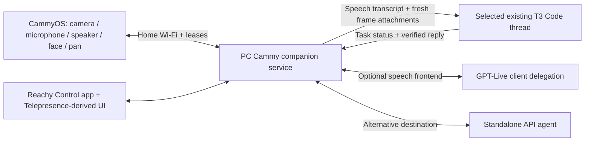

# Cammy: Reachy control, T3 threads, voice and vision

Research and plan,2026-11-15; implementation update2026-11-16. The PC agent service,
standard MCP tools, T3 CLI adapter and Reachy-app thread panel are now implemented
and installed. See [implementation/evidence](../T3-CONTROL-IMPLEMENTATION.md).
The original research below describes the target and remaining options. A full
spoken T3 turn, GPT-Live session, browser duplex path and RC2 hardware acceptance
remain unverified. Overnight development sent no real T3 messages, made no paid
inference calls and played no audio; local dependency/service installation and
a silent real-device control test were performed.

## Product target

Cammy is a physical audiovisual interface to Adam's selected existing T3 Code
threads, with their ongoing project context, tools and work, as well as an optional
standalone API-chat mode. These are selectable destinations of one companion
service. T3 should remain the authoritative task/history context in thread mode.
A generic voice assistant that can only occasionally ask another bot a question
does not satisfy this target. Voice selection stays independent of OS/transport.

## Recommendation

Keep Reachy Mini Control as the app host and the Reachy SDK as the upstream
compatibility target. Build the missing Cammy body/media adapter and a PC companion
service with a T3 transport adapter. Reuse the official Telepresence app as the
browser control reference; do not build another WebRTC stack from scratch.
Use Pipecat if a maintained voice pipeline is needed after the first thread-backed
turn works. Keep the currently proven GStreamer/Reachy receive path during that
step. LiveKit is a future option for multi-user/remote rooms, not a prerequisite.
These are engineering recommendations from the current code gaps and sources.

The installed reference is Reachy Mini Control0.9.38 with SDK/daemon1.14.0.
Its base daemon is explicitly a mockup with media disabled. Our real Cammy app
and receive-only media extension are separate; the generic reference robot's
pose state must never be presented as Cammy feedback. Existing browser preview
is JPEG, while the real WebRTC profile admits native loopback clients and rejects
browser Origins. Full browser duplex and the Cammy-backed daemon subset still
need implementation. See [compatibility](REACHY-COMPATIBILITY.md) and
[measured media contract](REACHY-MEDIA-2026-11-15.md).

## Open-source options

| Component | What upstream provides | Fit for Cammy |
| --- | --- | --- |
| Pollen Reachy SDK + Telepresence | Browser/WebRTC robot media and control; Telepresence supplies video, two-way operator audio and head joystick. Its glue is MIT; SDK licenses remain separate. | Preferred robot-controller reference. Adapt its physical controls to Cammy capabilities rather than pretending Cammy has Reachy's full head/base. |
| Pollen Conversation App | Realtime voice, camera tool, motion tools, local Python extensions and HF MCP Tool Spaces; Apache2.0. | Useful conversation/UI/tool patterns. Its default backend is not an existing T3 thread. Local extensions are the relevant seam. Its Tool Spaces installer is not a generic arbitrary-MCP-URL installer. |
| Pipecat | Open voice/multimodal pipelines; SmallWebRTC offers peer-to-peer audio, video and data. Core BSD2-Clause. | Preferred optional voice orchestration framework for one PC/desk robot. It is not a robot driver or calibrated body controller. A custom T3 backend processor is still required. |
| LiveKit Agents | Open voice-agent framework, rooms/media and sampled-video/vision support; Agents Apache2.0. | Strong alternative when remote participants, shared rooms or deployment needs justify a room server. Does not eliminate T3 or M105 adapters. |

Sources: [Reachy SDK runtime](https://raw.githubusercontent.com/pollen-robotics/reachy_mini/main/docs/source/SDK/javascript-sdk.md),
[Telepresence source/README](https://huggingface.co/spaces/pollen-robotics/telepresence/blob/main/README.md),
[Conversation App](https://github.com/pollen-robotics/reachy_mini_conversation_app),
[Pipecat SmallWebRTC](https://docs.pipecat.ai/api-reference/server/services/transport/small-webrtc),
[Pipecat license](https://github.com/pipecat-ai/pipecat/blob/main/LICENSE),
[LiveKit vision](https://docs.livekit.io/agents/multimodality/vision/video/),
[Agents license](https://github.com/livekit/agents/blob/main/LICENSE).

The Telepresence README currently describes an older private-sender workaround;
the current Reachy SDK reference exposes `setOutgoingAudioTrack()` and
`clearIncomingAudio()`. Prefer supported public APIs and pin/test the actual
installed SDK version before adopting a new app. Do not copy private `._pc`
access just because a reference app used it. Browser echo cancellation at the
operator microphone does not establish cancellation for Cammy's shared ALSA mic.
Upstream HF signaling/login is also a deployment choice to evaluate, not a reason
to replace Adam's LAN/T3 Connect preference or publish the local control service.

## Does GPT-Live need a second model for video?

GPT-Live-1 supports audio and text, not image/video input. OpenAI explicitly routes
images to a vision-capable backend; the voice frontend can talk while the backend
works. Client delegation allows the application to use its own agent/harness.
Therefore a good eventual split is a speech frontend plus the existing T3 agent,
with camera images going directly to that vision-capable thread. A separate third
vision model is optional, not inherently necessary. Two roles can overlap; both
need not be doing inference continuously or running locally on the camera.

Sources: [model modalities](https://developers.openai.com/api/docs/models/gpt-live-1),
[visual input and client delegation](https://developers.openai.com/api/docs/guides/live-delegation),
[migration guidance](https://developers.openai.com/api/docs/guides/live-migration).

The simplest first implementation needs no GPT-Live at all: local STT -> selected
T3 thread, with a fresh image -> local TTS -> Cammy. This preserves the real thread
as the sole reasoning backend. It will be more turn-based; measure it before
adding a realtime voice frontend. Later GPT-Live can supply smoother listening,
interruptions and short conversational acknowledgements while T3 handles tasks.
In that mode T3 task results and permissions remain authoritative; the speech
frontend must not invent completion or answer a visual question without grounded
backend evidence.

## Proposed PC service and data flow

The service owns one live device session, audio buffers, fresh video ring,
playback/cancellation and face/head state. It exposes narrow named robot tools;
model output is not a shell command. Conversion/encoding/inference stay on PC.
The M105 keeps compact drivers, the stock hardware owner and CammyOS guardians.
The display face uses local rendering/assets and small expression commands.

The desktop panel needs: explicit selected project/thread, T3/API mode, connection
and frame age, Idle/Listening/Thinking/Speaking, Talk/Mute/Stop, transcript, camera
view and capability-limited pan/face controls. No fabricated Reachy6DoF pose or
body yaw; unsupported pitch/base/calibrated movement remains unavailable.

## T3 adapter contract and actual evidence

The resident adapter now uses the installed public T3 CLI for thread list/read
and queued text sends. Actual list/read requests work from the PC service
environment without a provider's thread credential. Sends and run correlation
are tested against a fake CLI; no actual user task was sent overnight. Standard
Cammy MCP image tools provide vision in the selected agent session. The CLI has
no image-attachment flag, so automatic native image attachments are not claimed.
External T3 MCP OAuth remains an optional future seam. Do not modify T3's database,
scrape its UI or reuse provider/subscription tokens as application credentials.

The adapter should:

1. Bind conversation to an explicitly selected existing thread/project/provider.
   Retain its identity across voice reconnects; never silently create a fresh
   stateless replacement. Advertise whether that provider supports image input.
2. Send a final utterance once with a stable request ID and fresh frame(s), boot,
   session and capture timestamps. Keep a local durable outbox/receipt. Attachment
   send metadata currently has no retry key, so reconcile uncertain delivery
   before resending; do not duplicate coding work.
3. Respect T3 busy/queued/steering semantics. Preserve the existing run unless the
   user explicitly asks to interrupt/restart. Coalesce corrections into the
   intended task rather than spawning a new backend on every partial transcript.
4. Consume supported response/activity events, or bounded incremental reads if
   an event interface is unavailable. Speak useful assistant text, not raw tool
   dumps or hidden reasoning. Distinguish acknowledged, queued, running, waiting
   for user, completed and failed. Do not speak “done” on a send acknowledgement.
5. Keep a visible selected-thread indicator. “Stop speaking” cancels local output;
   cancelling the coding task is a separate explicit action. Preserve existing
   permission/confirmation requirements and route questions back to Adam.
6. On disconnect, stop output/capture as the chosen session policy requires;
   retain thread/task identity. Drop stale provider/audio results on reconnect.

No real T3 messages or images were sent during research or overnight development.
The actual utterance → selected thread → fresh image tool → spoken reply path
still needs an end-to-end proof with a selected vision-capable provider.

## Seeing through live video

Keep the live video stream for human viewing and local tools. For the selected
T3 vision model, initially attach a fresh JPEG at the completed utterance; when
discussing motion, use a small timestamped sequence/contact sheet. Reject old
frames or mark them stale. Test with a newly changed object that was not present
in earlier context. That is sampled visual reasoning from a live camera, not a
claim that every video frame reaches the model. Add low-rate change-triggered
visual context only after the basic path is correct. A text-only T3 provider must
report the limitation or use an explicitly chosen vision helper.

Keep media in bounded RAM by default. Avoid flooding project threads with every
frame or creating continuous TF recordings. No cloud image/audio forwarding in
Idle. GPT-Live must not be told it directly sees the camera when only its backend
does. Timestamp/ground the backend's visual answer in the spoken reply.

## Execution order and acceptance

1. **RC2 wireless speaker + existing media acceptance.** Perform the checked
   bootstrap transaction and one explicit boot with the staged TF. Hear generated
   speech delivered over home Wi-Fi, then overlap speaker with real video/mic,
   check Stop/disconnect and idle cleanup. Finite5s speaker jobs are a foundation,
   not seamless streaming; measure chunk gaps and cancellation before extending
   to a small bounded output ring/stream. Track reset/fallback evidence.
2. **First real T3 voice-and-vision loop.** PC-side push-to-talk, existing local
   STT/TTS, one selected existing thread. Speak three follow-up turns about that
   thread's project and a newly changed physical object. Verify the actual thread
   receives the text/image, retains prior context and its reply comes from Cammy.
   This is the next major end-user milestone, ahead of a controller rewrite.
3. **Natural conversation pipeline.** Reuse Pipecat components if helpful; compare
   the simple chain with GPT-Live client delegation to that same T3 adapter.
   Measure response latency and interruption; reuse established VAD components
   instead of inventing a detector. First handle speaker echo with explicit PTT/
   turn gating, then validate an echo-reference/AEC strategy on the real hardware.
4. **Reachy controller integration.** Add the T3 selector/state/Talk/Stop to the
   existing Reachy Cammy app. Prototype official Telepresence UI against the
   supported Cammy daemon subset and authenticated browser transport. Preserve
   supported upstream contracts, including return audio and cancellation. Avoid
   migrating the working media path until a replacement passes the same tests.
5. **Camera-side conversation UX and endurance.** Explicit Robot mode, record
   button Talk/Conversation activation, visible mic state, face expressions and
   return to Idle. Physical record-button suppression/remap and touch actions
   need implementation, not just artwork. Then repeated cold boots, prolonged
   concurrent sessions, Wi-Fi recovery, Stop and stock rollback acceptance.

Only implementation experiments should choose a voice framework dependency.
The research itself installed none. The later PC control milestone installs the
official MCP SDK and refreshes idle PC services; camera firmware remains unchanged.

## Proposed bandwidth/latency checks

Retain the15Mb/s aggregate LAN target as a measured goal. A proposed starting
budget is roughly2Mb/s encoded video plus tens of kb/s per Opus audio direction,
small face/control messages and overhead reserve. These are design targets, not
current native encoder measurements. Raw mono16k S16 audio is256kb/s per direction;
base64 output increases payload by roughly one third. Count incoming stock RTSP
as well as PC WebRTC traffic. Downscaling/limiting PC display FPS alone does not
lower camera-to-PC bitrate. Record capture-to-playback latency, audio queue age,
frame freshness and echo/interrupt behavior separately from network bandwidth.
